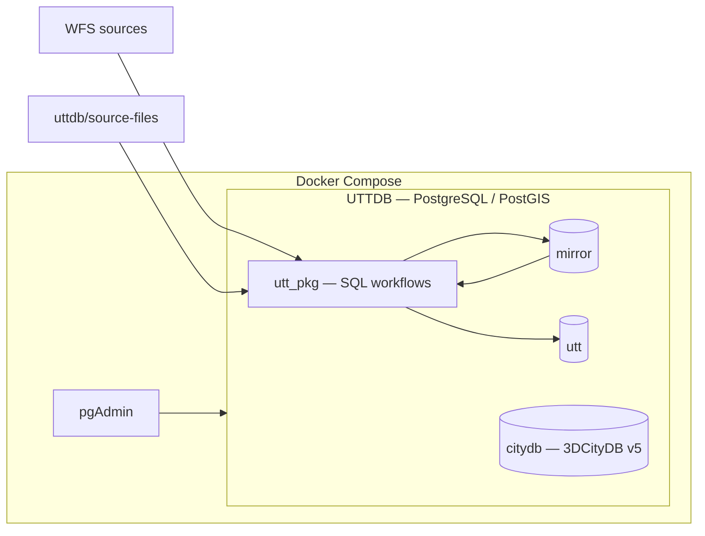

# Architecture

The stack runs UTTDB and pgAdmin in one Docker Compose project. Ingestion,
acceptance and optional domain curation run inside PostgreSQL/PostGIS through
`utt_pkg`; there is no separate ingestion worker. Arrows show access and data flow.

`mirror` owns dataset registration, ingestion evidence and accepted source history.
Row adapters feed one pending staging snapshot per dataset, then versioned `_stored`
tables with read-only current views. Native files follow the same acceptance
boundary, with reference history in `mirror.registry` and payloads outside PostgreSQL.
`mirror.import` tracks attempts and immutable acceptances; `mirror.source_columns`
retains reusable column-definition sets needed to interpret row history.

`utt` owns optional domain versions, mapping revisions, selected-contributor
provenance and spatial relations. Curation reads accepted inputs and commits domain
changes with their origins. Restricted SQL routines control pipeline writes;
developers work in sandbox schemas. Publication-coordinated locking keeps accepted
inputs consistent during curation while ordinary metadata reads remain available.

Source and domain versions share one system-time axis. Current views and as-of
functions read that history without duplicating it. Relations connect immutable
endpoint versions and derive time from their overlap. The `citydb` schema provides
3DCityDB's model for interoperability; source registration does not require domain
curation or a copy in `citydb`.

PostgreSQL state persists in `uttdb/data/`; pgAdmin accounts/settings persist in
`pgadmin/data/`. Original datasets live separately in `uttdb/source-files/`, mounted
read-only at `/source-files`. Database backups do not include those source files;
retrieving historical native bytes depends on retaining their version-specific files.

See the [metadata model](metadata-modelling.md) for storage and versioning behavior,
the [glossary](glossary.md) for terms, and [UTTDB](uttdb.md) and [pgAdmin](pgadmin.md)
for operational calls and access.
