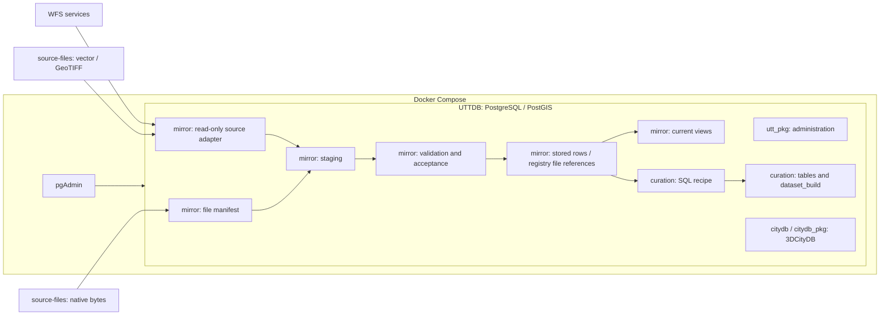
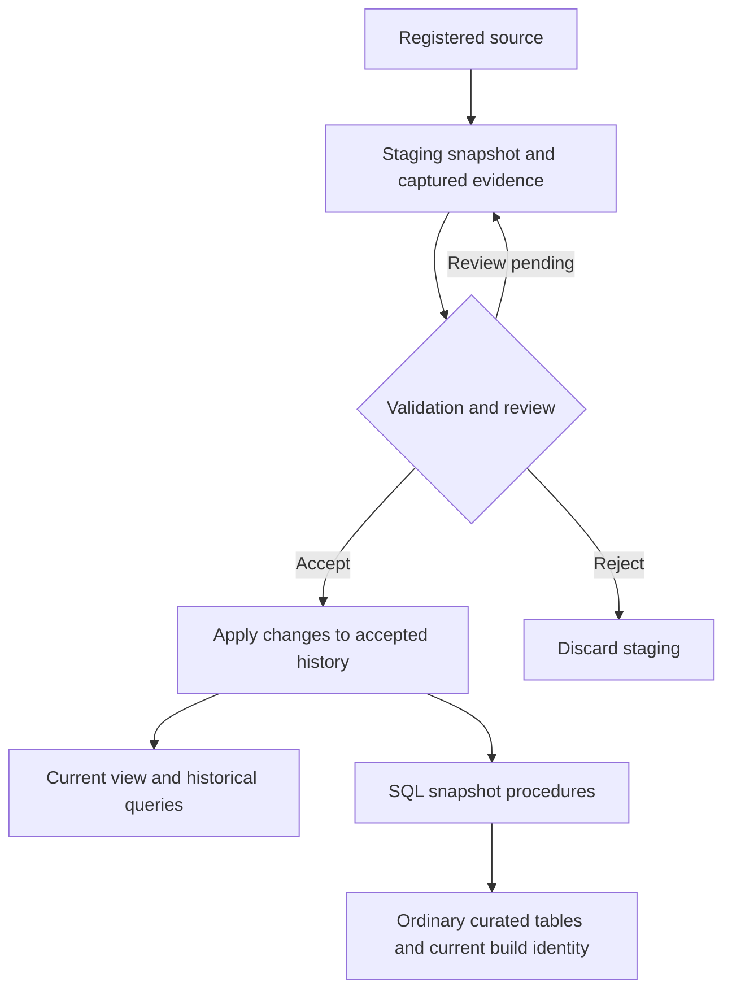

# Architecture

UTT is a PostgreSQL/PostGIS research data infrastructure based on 3DCityDB v5.
It captures heterogeneous data before optional domain interpretation. Its core is
SQL and database extensions rather than an external orchestration platform. This
keeps source-management behavior in one inspectable database and avoids requiring
researchers to operate a collection of infrastructure tools. Existing PostgreSQL,
PostGIS, OGR and 3DCityDB capabilities provide storage, spatial processing, adapters
and interoperability; UTT supplies the shared registration/acceptance conventions.

## Contents

- [Components and schema boundaries](#components-and-schema-boundaries)
- [Storage responsibilities](#storage-responsibilities)
- [From source to accepted history](#from-source-to-accepted-history)
- [One system-time axis](#one-system-time-axis)
- [Snapshot curation and build identity](#snapshot-curation-and-build-identity)
- [Publication and concurrency](#publication-and-concurrency)
- [Berlin model and spatial relationships](#berlin-model-and-spatial-relationships)
- [Privilege architecture](#privilege-architecture)
- [Maintenance responsibilities and integrity](#maintenance-responsibilities-and-integrity)
- [Raster limitations](#raster-limitations)
- [Persistence, scope and limitations](#persistence-scope-and-limitations)
- [Inspecting installed objects](#inspecting-installed-objects)

## Components and schema boundaries



`mirror` contains all source metadata, row/file history and ingestion routines.
`utt_pkg` contains shared administration. `curation` contains optional project
recipes and replaceable outputs. `citydb` and `citydb_pkg` provide the upstream
3DCityDB model and routines; CityGML is an interoperability option, not a required
copy of every source attribute. Extension objects remain in `public`; UTT-owned
implementation objects use their responsible schemas. Developer research objects
live in personal `sandbox_<login>` schemas.

Compose runs UTTDB and optional browser administration via pgAdmin, without an
external ingestion worker. The local image builds pinned OGR and HTTP extensions
on the digest-pinned upstream database image. The sourced `900-utt-init.sh` hook
processes mounted initialization files after upstream setup. 901 creates extensions
and core namespaces; 902 establishes privileges; 903 implements mirror; 913 creates
the optional Berlin project. Core 901–903 operate without any curation objects.
The dependency is one-way: curation reads accepted mirror state; mirror never calls
project procedures or acquires project advisory locks.

## Storage responsibilities

Four metadata tables describe accepted sources and the current curated build.
Source/import metadata lives in `mirror`; dataset build identity lives in `curation`.
Mirror routines live alongside their data in `mirror`, without a `mirror_` prefix.
Shared administration helpers live in `utt_pkg`; project procedures and tables
live together in `curation`, initialized by `913-curation.sql`.

| Table | Responsibility |
|---|---|
| `mirror.registry` | Dataset/layer identity `(source_name, layer_name)`, access/location, coverage, ownership, published metadata and ingestion settings. External-file datasets also keep their accepted reference versions here. |
| `mirror.import` | One ingestion attempt: captured location, coverage, revision/schema evidence, validation results and status (`staged`, `accepted`, `rejected`, `failed`). Acceptance makes the record immutable. |
| `mirror.source_columns` | Distinct immutable source-column sets needed to interpret history; imports reuse a matching `structure_version` rather than copying definitions each time. |
| `curation.dataset_build` | Current successful dataset recipe, Git revision when supplied, actual mirror snapshot, region and completion time. Updated atomically with output tables; no build history. |

Registry references use immutable `row_id` values. A database-row dataset has one
registration; an external-file dataset can have several reference versions with
the same logical identity. Retirement leaves referenced history available.

Each database-row dataset has these objects, using a unique registry-controlled base:

| Object | Responsibility |
|---|---|
| `mirror.<base>_source` | Read-only foreign table or adapter exposing the source. |
| `mirror.<base>_staging` | Pending snapshot for comparison and review; original source columns without UTT version metadata. |
| `mirror.<base>_stored` | Accepted source history: original state plus immutable `row_id`, stable-key representation `utt_key`, `utt_txn` and creating `import_id`. |
| `mirror.<base>` | Read-only current view over `_stored`; no duplicate storage. |

Curated city, district, block, plot, building and address tables are ordinary typed
snapshot tables. Three n:m relationship tables reference their snapshot-local row
IDs. They share the `berlin_` prefix and have no temporal modelling.

## From source to accepted history



A registered adapter captures into staging; validation either permits automatic
acceptance or holds that snapshot for review. Rejection discards the cache; read
failure records a failed attempt. Neither changes accepted state. Acceptance publishes
full-snapshot membership, so missing keys close current versions without asserting
real-world termination. Partial/delta ingestion is unsupported. The publication
section below describes comparison, concurrency and structural evidence in detail.

### Native files

External files such as NetCDF remain outside PostgreSQL. Their accepted versions
live directly in `mirror.registry`, with path/namespace, format, size,
checksum/algorithm, `file_txn` and creating import. A path is a location, not dataset
identity. Registration needs neither a parser nor geometry and does not decode
or curate native contents.

The same import lifecycle stages a manifest instead of decoded rows. Acceptance
rechecks readability and checksums against the pinned file. Changed bytes or
registered state, such as path/format, create a replacement reference version;
an unchanged reference records only an import. Missing files fail ingestion.

For example, logical dataset `temperature` can refer to `temperature-v1.nc` at T1
and `temperature-v2.nc` at T2. The registry retains both references. Historical
byte access depends on keeping both files unchanged at version-specific paths;
checksums cannot restore lost bytes. File retention/backups are separate duties,
and database rollback cannot undo filesystem changes. Rejection removes staging,
not the source file.

## One system-time axis

`utt_txn tstzrange` in row-history tables and `file_txn tstzrange` in the native-file
registry record **when UTT considered a state current**, not when an
object changed in the real world. Every version has an immutable `row_id` and a
repeatable logical identity. Nonempty half-open ranges `[start, end)` include the
opening instant and exclude the closing instant, so adjacent versions share a boundary
without overlapping. Openings are finite; current versions have unbounded endings. GiST exclusion constraints
prevent overlapping row versions for the same key and non-retired file ranges for
the same dataset. Retired native-file ranges can overlap later registrations;
retirement preserves their original bounds.

A content change closes the old version and opens its replacement at one timestamp;
historical attributes remain intact. The creating `import_id` identifies the
accepted input for a source version. Later unchanged imports remain visible in
import history without changing that version or its creating import.

Source dates remain ordinary attributes, with no generic `source_valid` or inferred
valid-time ranges. In the Berlin recipe, block `source_date` preserves `datum`,
plot `source_date` preserves `beg`, and address `address_date` preserves `aufn_dt`.
Changed mapped dates count as changed state even when the date moves backwards.
Advertised revisions do not date real-world changes or change snapshot selection.

## Snapshot curation and build identity

Curation reads one accepted mirror snapshot and optional region, using required
columns from the exact accepted structure at that time. The public Berlin procedure
resolves omitted/NULL snapshots after locking; explicit timestamps reconstruct
accepted history. It builds separate working tables before atomically replacing
outputs. Failed builds preserve the prior committed dataset.

Curated outputs have no system-time ranges or record history. `dataset_build` holds
only the current successful recipe, optional caller-supplied Git revision, actual
mirror snapshot, region and completion time. It is neither an execution log nor
per-record lineage. Reproduction requires retained SQL revisions, compatible mirror
history and dependencies; historic source bytes must also be retained where needed.
Build snapshot and completion time are different facts, not additional temporal axes.

## Publication and concurrency

Each capture locks its registration row. This serializes staging, definition-set
reuse and publication for a dataset; the unique pending-import index enforces at
most one pending snapshot. Row data is fetched into an ordinary staging table,
not streamed into history. Source-read failures roll back capture in a subtransaction
and leave a failed attempt, not an empty accepted delivery. Automatic publication
failure retains the cached snapshot and diagnostics for review.

Acceptance locks registration/import/staging and revalidates captured layout and
keys against current accepted state. It never substitutes a new remote row read for
the inspected snapshot. Native manifests are re-fingerprinted to verify their bytes.
Publication uses one timestamp for all range boundaries, accepted-import evidence
and registry summaries. Count thresholds are safeguards on full deliveries, not
proof of correctness. Accepted state and its evidence commit together.

Changed-row comparisons use native typed row text output under C collation and
`extra_float_digits=3`, retaining exact geometry/raster state. Whole-row JSON would
invoke GeoJSON conversions that reject some geometry types or round coordinates.
Only key encoding uses the canonical ordered JSON-array-as-text representation.
Creating imports are retained for unchanged versions, including across no-op imports.
A change of accepted structure evidence versions incoming rows even if values match.

Historical column sets are immutable and reused using ordinary SQL set comparisons
of names, order, types/modifiers, collation and descriptions. Removed physical
columns remain in history; additions produce historical NULLs. Current views expose
the accepted structure, so removed/reordered columns may require RESTRICT view
recreation and explicit resolution of dependent objects. No dependency is cascaded
away to force publication.

The Berlin build holds advisory transaction lock `(70303,1)` and EXCLUSIVE
`mirror.registry` throughout the transaction. This blocks new acceptance row locks
and schema changes while allowing plain reads, avoiding publication lock inversions.
It checks required column names against each source's accepted schema at the chosen
time. Its six entity steps create indexed temporary tables, then the relationship
step reads those same endpoints. Final DELETE/INSERT installation retains output
object identities and dependent queries; ordinary MVCC readers see committed data,
and all nine outputs plus build identity commit atomically. Locks last until caller
commit/rollback. Internal steps make no commits and are not application build APIs.

Batch refresh deliberately differs: a top-level procedure commits every selected
dataset independently, skips pending/recently accepted sources and does not discover
new layers. A later error cannot undo earlier commits. WFS metadata errors stop the
batch; source-read failures recorded by capture can be followed by later datasets.

## Berlin model and spatial relationships

The demonstration has six entity tables and three n:m tables, all prefixed `berlin_`.
Entity official identities are unique within a snapshot; identity `row_id` values
are local to the build. Relationship foreign keys refer to these endpoints, with
one row per unique pair. Intersection area / first-endpoint area is rounded to
three decimals and retained above 0.02 (and constrained at most 1). Spatial-index
candidate probes precede calculating each fraction; entity working tables and installed output tables
are analyzed. No historical endpoint combinations are materialized.

City `lan`, district `name`, block `blknr`, plot `rtrim(fsko,'_')` and address
`adr_ident` become bigint official IDs; building `uuid` remains text and `fid`
is retained as `source_fid`. Block/address district codes add 11000000 to `bez`;
plot `gdz` is cast directly. The block representative point uses the centroid if
covered by its geometry, otherwise a point on surface. Building `hoh` is trimmed,
blank becomes NULL and remaining values are cast to boolean. Unavailable enrichment
fields remain typed NULL; the recipe does not infer matching IDs, units or CRS.
Domain column mappings and original German comments are in
[913-curation.sql](../uttdb/init/913-curation.sql).

A NULL region selects the registered scope. Non-NULL regions must be compatible
with source CRS; intersecting geometries are retained whole. Curated relationships
have no independent temporal axis. Explicit snapshot reconstruction replaces the
current dataset rather than creating curated history. The public current default
is resolved after locking; internal step defaults are not the public interface.

## Privilege architecture

There are two NOLOGIN group roles: `utt_admin` and `utt_developer`. Humans use
individual LOGIN roles. Administrators own shared nonextension objects through
`utt_admin`; developers receive schema usage and SELECT across shared tables/views
and sequences, without advancing shared sequences, shared writes or general routine
execution. The read-only GeoTIFF helper has a specific developer execution grant.
OGR source-server usage remains administrative, so a table SELECT grant does not
by itself authorize direct live foreign-source access.

902 is the single privilege-policy location. Its bootstrap-owned security-definer
provisioning routines create individual accounts and sandboxes after checking the
administrator session. Ordinary admins are not superusers/CREATEROLE; bootstrap
ownership supplies the narrow role-provisioning boundary. Trusted admins inherit
server-file reads and GDAL parameter-setting permissions; this is not an untrusted
tenant boundary. Credential management and event-trigger maintenance require
appropriate bootstrap/deployment administration.

The `utt_shared_privileges` DDL event trigger assigns shared ownership and reads for
future objects independently of which administrator creates them. Extension members
are excluded; bootstrap-owned provisioning/hook routines keep their narrow ownership
boundary. The hook covers protected schemas and admin-owned sandboxes, not arbitrary
user schema names. Creator-specific defaults revoke PUBLIC routine execution and
allow developer table reads.

Ordinary developer sandboxes belong to their login. Admins inherit developer-login
membership for ownership access; admin research sandboxes instead use `utt_admin`
ownership to avoid cycles. Developers get peer sandbox usage and SELECT defaults,
but an owner can deliberately change its objects' ACLs. Provisioning reuses only a
correctly owned schema and does not reset work. Account deactivation sets NOLOGIN,
retaining sessions, objects and membership. Shared access uses the two implemented
roles; there is no generic application role.

## Maintenance responsibilities and integrity

Registry configuration and system-maintained evidence share one table; this does
not make accepted history manually editable. Administrators use public registration,
capture, acceptance, rejection, refresh and retirement routines. Developers read
shared state and manage their sandboxes. Imports, source-column definitions, stored
history and `dataset_build` are routine-maintained; manual rewriting is unsupported.

Registry fields have these maintenance responsibilities:

| Fields | Maintainer / allowed use |
|---|---|
| `stable_key`, `change_threshold_percent`, `coverage` | DBA ingestion configuration. Set stable keys before row ingestion; accepted keys and registered coverage cannot be repurposed. Every row import covers the registered scope; there is no per-attempt partial-delivery override. |
| `title`, `description`, `fees`, `access_constraints`, `source_owner` | Published metadata supplied explicitly or collected during registration, without inferred rights/ownership. Row registrations can be maintained by DBAs; accepted native-file reference attributes are immutable. |
| `row_id`, `source_name`, `layer_name`, `source_type`, `storage_mode`, `source_url`, `import_scope`, `table_base`, `registered_at`, `path_namespace`, `file_format` | Registration identity/access and storage contract, established through registration routines. Do not repurpose referenced identities or rename generated relations by editing the registry. |
| `stored_table` | Generated column derived from `table_base`; never edited. |
| `last_imported_at`, `source_revision_at`, `extent` | Routine-maintained acceptance/advertised revision/bounds summaries. |
| `file_txn`, `import_id`, `file_size`, `file_checksum`, `checksum_algorithm` | Accepted native-file reference evidence maintained by acceptance. NULL where inapplicable. |
| `retired` | Retirement state managed through `unregister_source`. |

The following internal triggers enforce immutable accepted state even against
accidental direct administrator writes. Superuser/owner DDL remains trusted; these
are integrity boundaries rather than an audit system against malicious DBAs.

| Trigger(s) / table | Trigger function | Enforced boundary |
|---|---|---|
| `protect_import`, `protect_import_truncate` / `mirror.import` | `protect_metadata` | Reject edits/deletion of accepted imports and truncation. |
| `protect_source_columns`, `protect_source_columns_truncate` / `mirror.source_columns` | `protect_metadata` | Preserve immutable definitions and prevent truncation. |
| `protect_registry`, `protect_registry_truncate` / `mirror.registry` | `protect_metadata` | Preserve referenced identity, accepted native-file evidence and accepted key/scope contracts; permit controlled closure, summaries and retirement. |
| `protect_history`, `protect_history_truncate` / each `_stored` table | `protect_history` | Check creating accepted-import ownership; reject deletion/state rewrites/truncation while permitting current-range closure. |

## Raster limitations

The GeoTIFF reader decodes with `ST_FromGDALRaster` and tiles with `ST_Tile`.
It assigns `rid` from output ordinality. Grid/band changes trigger review, but tile
numbers alone do not guarantee the same geographic identity across changed grids.
NoData metadata preservation has a reported unresolved issue. Existing grid-review
and count checks do not establish that raster statistics match the original file.

## Persistence, scope and limitations

PostgreSQL state is bind-mounted at `uttdb/data/`; pgAdmin state at `pgadmin/data/`.
Original files are separately mounted read-only from `uttdb/source-files/` to
`/source-files`. Credentials/settings live in ignored `.env`. Database backups do
not include source bytes. Historical native-file access requires retaining each
accepted file unchanged at its version-specific path plus separate backups; checksums
are evidence, not storage. Database rollback cannot reverse filesystem writes.

UTT captures only observed accepted states. Every row ingestion replaces membership
within the registered scope; partial/delta ingestion and inferred valid-time history
are unsupported. Original dates remain attributes. Schema and advertised metadata
have explicit evidence boundaries; missing ownership/license/revision values are
not invented. Row-registry descriptive metadata is current, not a version archive
of every metadata response.

The code includes disposable-database regression checks for mirror/history, exact
spatial values, file lifecycle, structure reuse, privilege boundaries, core independence
and Berlin reconstruction. A full-scale Berlin run has been reported by the project;
this review uses static inspection and does not certify every external adapter/service
or production backup/recovery scenario. Berlin is a project-specific prototype rather
than a universal urban ontology.

## Inspecting installed objects

The [API Reference](api-reference.md) lists all UTT-owned routines with exact
signatures and callers. The [User Guide](user-guide.md) provides the operational
workflow and disposable-test requirements.
These catalogue queries reveal generated relations and actual installed definitions:

```sql
SELECT n.nspname AS schema_name, c.relname AS object_name,
       CASE c.relkind WHEN 'r' THEN 'table' WHEN 'p' THEN 'partitioned table'
         WHEN 'v' THEN 'view' WHEN 'f' THEN 'foreign table' END AS object_type,
       c.relispartition AS is_partition, obj_description(c.oid) AS description
FROM pg_class c JOIN pg_namespace n ON n.oid=c.relnamespace
WHERE n.nspname IN ('mirror','utt_pkg','curation') AND c.relkind IN ('r','p','v','f')
ORDER BY 1,2;

SELECT p.oid::regprocedure AS routine, p.prokind,
       p.prorettype='trigger'::regtype AS is_trigger_function,
       obj_description(p.oid) AS description
FROM pg_proc p JOIN pg_namespace n ON n.oid=p.pronamespace
WHERE n.nspname IN ('mirror','utt_pkg','curation') ORDER BY 1;

SELECT t.tgrelid::regclass AS relation, t.tgname AS trigger_name,
       t.tgfoid::regprocedure AS function, pg_get_triggerdef(t.oid) AS definition
FROM pg_trigger t JOIN pg_class c ON c.oid=t.tgrelid
JOIN pg_namespace n ON n.oid=c.relnamespace
WHERE n.nspname IN ('mirror','utt_pkg','curation') AND NOT t.tgisinternal
ORDER BY 1,2;
```
