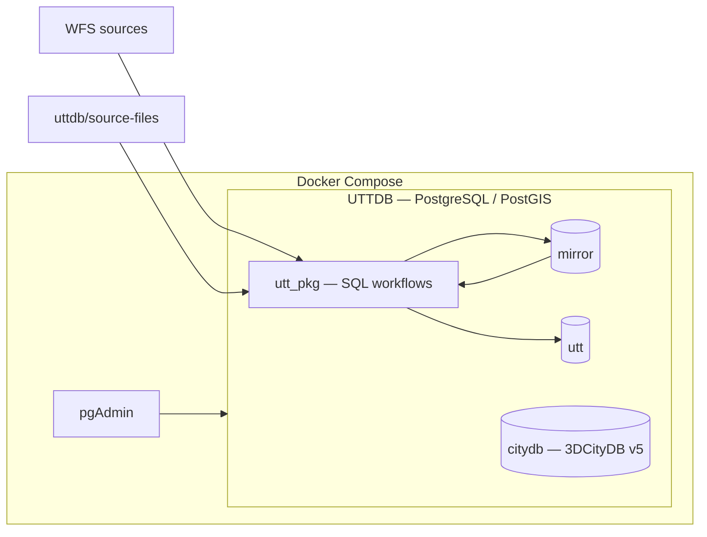

# Architecture

The current stack runs in one Docker Compose project. Arrows show existing access
and data flow.

UTTDB persists in `uttdb/data/`; pgAdmin persists in `pgadmin/data/`.
Original source files remain separate from database storage. See
[UTTDB](uttdb.md) and [pgAdmin](pgadmin.md) for operational details.
