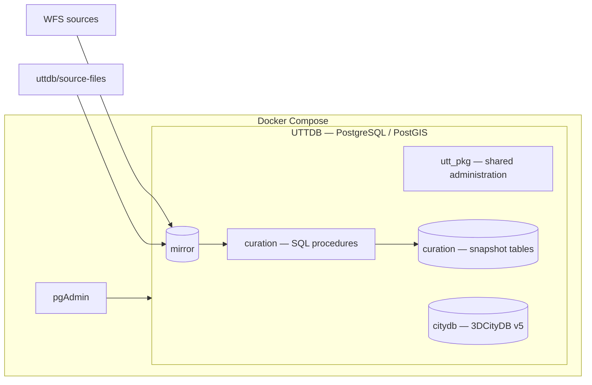

# Architecture

The stack runs UTTDB and pgAdmin in one Docker Compose project. Ingestion,
acceptance and optional domain curation run inside PostgreSQL/PostGIS through
`mirror` and `curation`; there is no separate ingestion worker. Arrows show access and data flow.

`mirror` owns dataset registration, ingestion evidence and accepted source history.
Row adapters feed one pending staging snapshot per dataset, then versioned `_stored`
tables with read-only current views. Native files follow the same acceptance
boundary, with reference history in `mirror.registry` and payloads outside PostgreSQL.
`mirror.import` tracks attempts and immutable acceptances; `mirror.source_columns`
retains reusable column-definition sets needed to interpret row history.

`mirror` includes its own ingestion routines without a redundant name prefix,
for example `mirror.store_layer()`. `utt_pkg` holds shared administration helpers
such as developer sandbox provisioning. Both work without a curation schema. Optional `curation` holds project-specific SQL procedures and their
ordinary snapshot tables. The Berlin recipe builds six entity tables, then three
n:m relationship tables, all with the `berlin_` prefix. Indexed temporary working
tables support stepwise processing; one transaction installs the complete dataset
and its `dataset_build` identity. Pipeline users call the restricted build procedure;
developers work in sandbox schemas.

Only mirror maintains source system-time history. A recipe selects one timestamp
and optional region; curated outputs have no record-version history. The Berlin entry point
automatically selects one current timestamp or accepts an explicit historical time. Reconstruction replaces the
current dataset; failure preserves the prior complete result. The recipe holds an
exclusive lock on `mirror.registry` while reading inputs, blocking source publication
and schema changes while allowing ordinary metadata reads. Publication interfaces
and their schema placement are not defined.

The `citydb` schema provides 3DCityDB's interoperability model. Source registration
and curation do not require a copy of every attribute in `citydb`.

PostgreSQL state persists in `uttdb/data/`; pgAdmin accounts/settings persist in
`pgadmin/data/`. Original datasets live separately in `uttdb/source-files/`, mounted
read-only at `/source-files`. Database backups do not include those source files;
retrieving historical native bytes depends on retaining their version-specific files.

See the [metadata model](metadata-modelling.md) for storage and versioning behavior,
the [glossary](glossary.md) for terms, and [UTTDB](uttdb.md) and [pgAdmin](pgadmin.md)
for operational calls and access.
