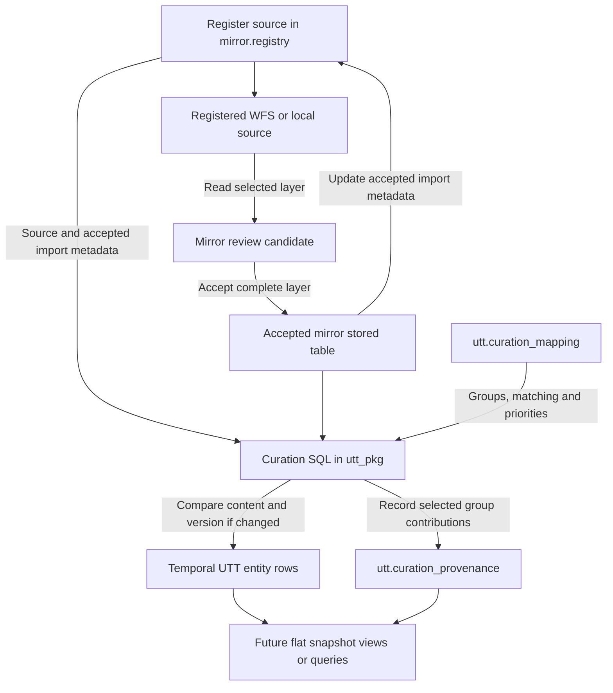
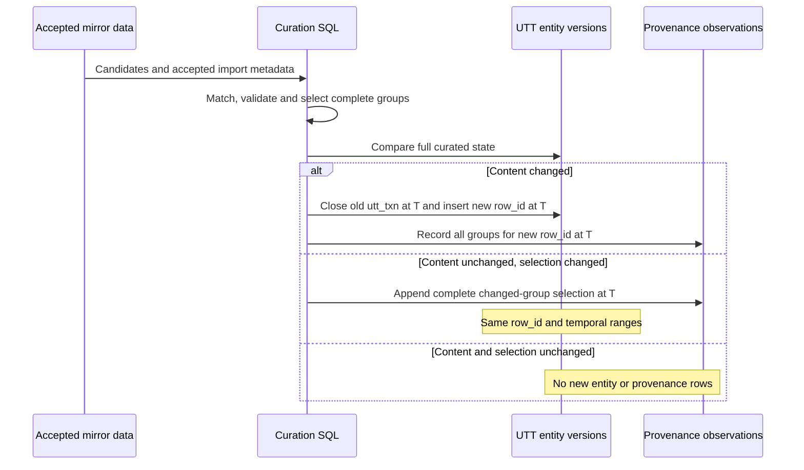

# Curation mappings and temporal provenance

## Status and scope

This is the agreed design for later implementation, not a description of already
implemented functionality. It replaces the earlier broader framework proposal.
No database objects are introduced by this document.

Use three metadata tables: the existing `mirror.registry`, plus
`utt.curation_mapping` and `utt.curation_provenance`. Curated entity tables remain
in `utt`; cross-schema routines remain in `utt_pkg`. Keep the existing six entity
curation routines and introduce mapping support incrementally.

Track source → accepted mirror data → curated UTT values. Defer operation and
execution registries, source archives, generic execution frameworks, exports,
simulations, result imports and subsequent processing of UTT data. A guided admin
interface for registration and mapping can later call the same database routines;
for now, use SQL and database validation.

## Data flow and responsibilities



The registry describes a source layer, mappings describe possible contributions,
and provenance records actual selected contributions. Mirror data tables and UTT
entity tables hold the data itself; they are not additional metadata registries.

## 1. Source registry

Keep `mirror.registry` and its existing composite primary key
`(source_name, layer_name)`. Reuse its stored-table name, source location, published
metadata and geographic extent. Do not copy these into the mapping table.

Mirror acceptance copies a complete selected layer without curation or intentional
changes to source values. A service can expose many layers while only one is
accepted into local storage. This is layer selection, not an atomic attribute
group; reserve that term for attributes selected together into the UTT model.

Reduce the registry to two clearly named timestamps:

| Proposed column | Meaning |
|---|---|
| `imported_at` | Database time when the current complete layer was successfully published to local storage; NULL before first acceptance. |
| `data_revision_at` | Source-reported revision reliably associated with that stored layer; NULL when unknown or not reliably associated. |

Rename `last_imported_at` to `imported_at`. Replace the existing meaning of
`source_revision_at` with `data_revision_at`: it describes accepted data, not the
latest advertised revision. Remove `registered_at`; registration age is not needed
for value provenance. Do not add review or latest-advertised revision timestamps.
This deliberately gives up registration-age reporting and persistent tracking of
whether a service advertises something newer than the stored data.

Store revision information with a pending review candidate as internal relation
metadata, for example a documented structured table comment, so delayed acceptance
can carry the captured revision without another registry column or table. Read and
validate that metadata during acceptance. If a candidate has no reliable captured
revision, publish NULL; never infer it from a newer service metadata response.
Even capture during download does not prove that a changing remote service supplied
that exact revision; preserve NULL when that association cannot be established.

Acceptance updates stored rows, `imported_at`, extent and `data_revision_at` in one
database transaction. Failed or pending reviews leave accepted metadata unchanged.
Curation reads accepted rows and their metadata under locking coordinated with
publication, including delayed manual acceptance.

This is a proposed live-interface change, not just a rename in documentation.
Before implementation, check registration, refresh, acceptance, curation and other
callers, plus the existing timestamp constraint. Never relabel existing advertised
revision values as accepted revisions without evidence; initialize the new revision
to NULL where the association is unknown. No live database change is made here.

Retain registry entries referenced by mappings. Unregistration must reject their
deletion rather than cascade into historical provenance. Source identity/location
must not be repurposed on a referenced registration: register a distinct source
when its identity changes. Descriptive metadata remains current registry metadata,
not an archived copy of every historical service response.

## 2. Mapping definitions: `utt.curation_mapping`

One row defines one candidate source for one target attribute or atomic group.

| Column | Meaning |
|---|---|
| `mapping_id` | Primary key; also identifies an immutable definition revision. |
| `source_name`, `layer_name` | Composite foreign key to `mirror.registry`. |
| `source_columns text[]` | Nonempty list of columns consumed from the accepted source table. |
| `target_table` | One of the supported entity table names within `utt`. |
| `target_columns text[]` | Nonempty list of target state attributes selected together. |
| `priority` | Lower numbers win among eligible mappings for the same target group. |
| `rule_name` | Approved transformation/matching rule in `utt_pkg`; NULL for direct copying with the entity's established identifier matching. |
| `active` | Whether the mapping is considered for new selections. |

Column arrays describe inputs and outputs, not necessarily positional pairs. An
approved SQL rule defines calculations, matching, missing-value handling and group
eligibility. Do not store arbitrary executable SQL or invent a JSON rule language.
JSONB is needed only for small composite source-record keys in provenance.

Validate identifiers and types against PostgreSQL catalogs. Exclude UTT-generated
metadata such as `row_id` and `utt_txn` from mapped state attributes. Approved rule
implementations must remain identifiable and available for historical definitions:
use a new rule identifier when behavior changes, rather than silently replacing
the meaning of an old one. No separate transformation registry is required.

### Atomic groups and competing sources

Group membership is the set of target column names, independent of array ordering.
Reject empty arrays, duplicate members and partial overlap between active groups
for the same target table. Competing mappings must address exactly the same group.

For example, `(geom, name, function)` can be one group from source A, while
`(construction_year)` is a separate group with candidates from sources A and B.
A construction-year candidate cannot compete with `(geom, construction_year)`.
These names illustrate the rule; actual mappings must use existing columns and
verified sources. The current building routine does not curate construction year.

An atomic group is selected in its entirety. Do not take one member from one
candidate and another member from a different candidate. A rule specifies whether
NULL members are legitimate or make the complete candidate ineligible. Attributes
requiring independent fallback or priorities must be separate groups.

Referenced mapping definitions are immutable except for activation status. Changes
to columns, priority, source or rule create a new mapping row and deactivate the
old one. Activation governs future processing; it does not erase historical use.
Changing group boundaries requires explicit re-curation that establishes a full
new selection observation; do not reinterpret old provenance using new groups.

## 3. Actual origins: `utt.curation_provenance`

One row records one selected source-record contribution to one atomic group of one
immutable UTT entity version. Most groups have one contributing record; a group
computed from several records has several contribution rows.

| Column | Meaning |
|---|---|
| `provenance_id` | Primary key. |
| `recorded_at` | Database system-time observation timestamp, shared by all contributions in one group selection. |
| `mapping_id` | Foreign key to the exact mapping definition used. |
| `city_row_id`, `district_row_id`, `block_row_id`, `plot_row_id`, `building_row_id`, `address_row_id` | Nullable foreign keys to actual entity versions; exactly one must be set. |
| `source_record_key jsonb` | Named source key fields, e.g. `{"uuid":"example"}`; supports composite keys. |
| `source_imported_at` | Accepted snapshot's `imported_at`, copied when that input is selected. |
| `source_revision_at` | Accepted snapshot's `data_revision_at`, copied if known. |
| `selection_reason` | Short factual reason, such as highest-priority eligible candidate or fallback after higher-priority candidates were missing/invalid. |

Explicit entity foreign keys avoid another target registry and prevent dangling
`(table_name, row_id)` references. Validate that the populated FK agrees with the
mapping's target table. Index target-version references, mapping references and
observation timestamps. Prevent duplicate contributions within an observation.
The source key must be stable within the accepted snapshot; never use physical
row positions such as `ctid`. Reject unsupported record-level provenance when a
rule cannot supply an unambiguous key.

Source identity, columns, group, priority and rule come through the immutable
mapping, so provenance does not repeat them. Do not store target values again or
persist every losing candidate. A concise selection reason documents the decision,
but is not a complete historical snapshot of all rejected candidates.

### Keeping provenance small and historically coherent

Record one contribution per group, not per attribute. A mapping supplying geometry
and fifteen descriptive attributes from one source record normally needs one
provenance row per target version.

Append a new group observation when its selected mapping or contributing source
records change, even if target values remain identical. Write the full selected
contribution set for that group together, using one timestamp. This ensures that
an earlier contributor removed from a multi-record calculation does not appear
in the later selection. Observations for the same target/group must be serialized
and have distinct, strictly increasing timestamps.

An unchanged selection and unchanged target content do not add observations just
because the source was refreshed. The stored import metadata identifies the
snapshot used when the origin was established or last changed; it is not a log of
every later verification. Content changes always create a new target version with
new provenance, even if the source record key remains the same.

Do not silently clear a group when no eligible source remains. Default to retaining
existing content and its origin, or failing the operation if the rule requires a
candidate. A rule that clears content or declares an independent withdrawal event
needs explicit semantics and a representation of no-source observations before
it is supported. Missing source objects are not deletions by default.

## 4. Bitemporal entities and other time values

Preserve the existing [temporal model](temporal-model.md).

| Value | Interpretation |
|---|---|
| Stable entity ID | Logical object identity repeated across versions; not a timestamp. |
| Entity `row_id` | Immutable identity of one stored version. |
| Entity `source_valid tstzrange` | Optional valid time: when the source says the state applies. |
| Entity `utt_txn tstzrange` | Mandatory system time: when UTT considered that version current. |
| Registry `data_revision_at` | Source-reported revision associated with accepted data, if known. |
| Registry `imported_at` / provenance `source_imported_at` | Successful local publication event identifying an observed mirror snapshot. |
| Provenance `source_revision_at` | Retained accepted-input revision for this contribution. |
| Provenance `recorded_at` | System-time event when UTT established the recorded selection. |

Only valid time and system time are entity time axes. Revision,
publication and provenance observations are events or input metadata, not extra
validity axes. They do not replace unknown valid time, which remains NULL.

Entity ranges remain half-open `[start, end)`. For one stable ID, `utt_txn` ranges
must not overlap. Also exclude overlapping `source_valid` ranges when `utt_txn`
ranges overlap, using the existing GiST constraints.

Compare geometry and every curated state attribute before versioning. A revision,
validity-date or provenance-only change leaves the target content and its ranges
unchanged. For changed content, use one database timestamp to close the previous
`utt_txn` and open the next. Use that same timestamp for the new provenance.
With a newer source-valid opening, close the former valid range there; with the
same opening, preserve the range; reject an older opening. Unknown validity stays
NULL unless a documented source-specific rule supplies an approximation.

The current city, district and building rules use dataset revision as a documented
valid-time approximation. During implementation, use the accepted revision rather
than the latest advertised revision. Block uses `datum`, plot uses `beg` and address
uses `aufn_dt`. Keep those rules in their curation SQL.

Several groups can have different source dates. The entity still has only one
`source_valid` range: the entity's approved curation rule must define how it is
established and whether a supplementary source is eligible for that state. Do not
silently choose the latest ingestion time or claim independent attribute validity.
If independent valid-time histories are needed later, this entity-level model
requires an explicit domain design beyond this phase.

A new entity version receives provenance for every populated managed group,
including unchanged groups carried forward from the preceding version. Historical
provenance stays attached to its original `row_id`. For an unchanged target version,
a changed source selection adds observations against the same `row_id`.



## 5. Curation workflow

1. Register the WFS/file source using existing `utt_pkg.mirror_*` routines. Build,
   review and accept local data before curation; never curate directly from live
   WFS responses.
2. Define mappings with explicit source columns, target groups, approved rules and
   priorities. Validate identifiers, matching keys, types and group overlap.
3. Lock and read accepted snapshots and their metadata consistently. Validate
   geographic applicability using existing registry extents and the requested
   operation scope. Extents are bounding geometries, not verified complete coverage;
   report unknown or partial coverage honestly. No region registry is required.
4. Use ordinary set-based SQL where practical: produce eligible candidates, match
   them by identifier or approved spatial rules, and resolve each target/group by
   priority, then mapping ID, then a stable source key. Multi-record aggregation
   rules define their complete contributor set. Mapping interpretation happens per
   operation, not inside a per-feature metadata interpreter.
5. Compare the assembled target state and apply the existing temporal rules.
   Higher-priority additions and loss of selected values trigger fallback selection;
   updates to losing candidates alone must not create new target versions.
6. Write target changes and group provenance in one database transaction. Keep narrow existing
   privilege boundaries; database validation and routines govern writes. No separate
   execution record, workflow scheduler or operation table is required.

Mapping changes, source refreshes and source disappearance require re-evaluation;
no automatic scheduler is implied. A later interface can guide these same steps.

## 6. Future flat snapshots and inspection

The versioned entity tables remain the source of truth. Later views can expose
ordinary flat rows for QGIS and other consumers, without changing storage:

- **Current state:** versions with an unbounded `utt_txn` end. This means current
  database knowledge, not necessarily valid at the present real-world instant.
- **Historical system-time state:** versions whose `utt_txn` contains a requested
  time; answers what UTT knew then.
- **Bitemporal state:** versions containing both a requested system time and a
  requested valid time; answers what UTT knew then about that valid-time instant.

Illustrative queries against the existing entity model:

```sql
-- Current database state.
SELECT * FROM utt.building WHERE upper_inf(utt_txn);

-- State known at a system-time instant.
SELECT * FROM utt.building
WHERE utt_txn @> TIMESTAMPTZ '2026-10-01 12:00:00+00';

-- State known then about a valid-time instant.
SELECT * FROM utt.building
WHERE utt_txn @> TIMESTAMPTZ '2026-10-01 12:00:00+00'
  AND source_valid @> TIMESTAMPTZ '2025-06-01 00:00:00+00';
```

A NULL `source_valid` cannot establish validity at a requested instant. A strict
bitemporal snapshot excludes it; an optional view may expose unknown validity
explicitly rather than treating it as valid for all time.

A current flat snapshot can be a normal view. Arbitrary historical instants require
a parameterized SQL function or query, since ordinary views accept no parameters.
These interfaces are deferred, but the stored version identities support them.

For provenance at system time S, first select the target version at S, then the
latest group observation with `recorded_at <= S`, retaining every contributor from
that observation. Do not filter historic provenance by today's mapping activation.
For current database state, use the latest group observation on the current version.
Keep multi-record contributors in a separate inspection view or aggregate their
keys explicitly; a raw join must not multiply the flat entity rows accidentally.

Group-boundary changes need the complete replacement observation described above;
historical snapshots use the group definitions in effect in their observations,
not today's grouping. Views can show values alone or selected-source summaries.

## 7. Guarantees and implementation order

This design explains which mapping and source records supplied a stored UTT version,
and records selection changes without unnecessary value versions. It does not
retain every checked source snapshot, historical service metadata, rejected
candidate values or a complete execution audit. Mirror refreshes replace source
rows; import timestamps do not guarantee historical input reproducibility.

Implement accepted-revision handling first, then mapping validation, then integrate
one existing entity routine with group provenance. Verify content idempotency,
priority/fallback, atomic groups, temporal constraints, carried-forward groups,
selection-only changes, historical inspection and transactional consistency before
extending the other five routines. Use rollback-only database checks where practical.
No migrations or database implementation are part of this document revision.
