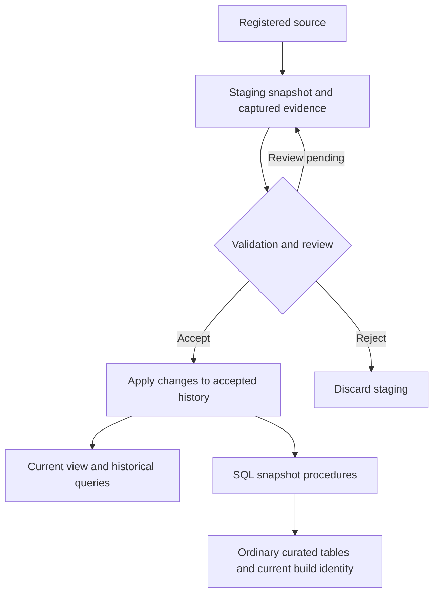

# Metadata, mirror history and snapshot curation

UTT captures heterogeneous source data in `mirror` and optionally curates it into
`curation` snapshot tables. Original attributes and geometry remain available; curation
harmonizes the data needed by an application. CityGML/3DCityDB provides an
interoperability interface for suitable data.

This guide describes the current fresh-initialization model. Editing initialization
SQL does not update an existing database. [UTTDB](uttdb.md) explains practical
workflows; the [glossary](glossary.md) defines terms. The
[database reference](database-reference.md) inventories objects, callers and maintenance
responsibilities. Routine
comments document detailed interfaces, and [AGENTS.md](../AGENTS.md) contains
implementation rules.

## Storage responsibilities

Four metadata tables describe accepted sources and the current curated build.
Source/import metadata lives in `mirror`; dataset build identity lives in `curation`.
Mirror routines live alongside their data in `mirror`, without a `mirror_` prefix.
Shared administration helpers live in `utt_pkg`; project procedures and tables
live together in `curation`, initialized by `913-curation.sql`.

| Table | Responsibility |
|---|---|
| `mirror.registry` | Dataset/layer identity `(source_name, layer_name)`, access/location, coverage, ownership, published metadata and ingestion settings. External-file datasets also keep their accepted reference versions here. |
| `mirror.import` | One ingestion attempt: captured location, coverage, revision/schema evidence, validation results and status (`staged`, `accepted`, `rejected`, `failed`). Acceptance makes the record immutable. |
| `mirror.source_columns` | Distinct immutable source-column sets needed to interpret history; imports reuse a matching `structure_version` rather than copying definitions each time. |

| `curation.dataset_build` | Current successful dataset recipe, Git revision when supplied, actual mirror snapshot, region and completion time. Updated atomically with output tables; no build history. |

Registry references use immutable `row_id` values. A database-row dataset has one
registration; an external-file dataset can have several reference versions with
the same logical identity. Retirement leaves referenced history available.

Each database-row dataset has these objects, using a unique registry-controlled base:

| Object | Responsibility |
|---|---|
| `mirror.<base>_source` | Read-only foreign table or adapter exposing the source. |
| `mirror.<base>_staging` | Temporary snapshot for comparison and review; original source columns without UTT version metadata. |
| `mirror.<base>_stored` | Accepted source history: original state plus immutable `row_id`, stable-key representation `utt_key`, `utt_txn` and creating `import_id`. |
| `mirror.<base>` | Read-only current view over `_stored`; no duplicate storage. |

Curated city, district, block, plot, building and address tables are ordinary typed
snapshot tables. Three n:m relationship tables reference their snapshot-local row
IDs. They share the `berlin_` prefix and have no temporal modelling.

## From source to accepted history



Ingestion compares explicitly configured stable keys and complete source state,
including geometry. New objects are inserted; changed objects receive replacement
versions; unchanged objects stay untouched. Valid snapshots pass automatically when
safety thresholds pass unless manual review was requested. Otherwise the snapshot
remains available for inspection. Manual acceptance publishes that same snapshot
without refetching and can override thresholds, but not integrity validation.

Each dataset has at most one pending snapshot. `mirror.import` retains its evidence
through acceptance or rejection; staging disappears after either decision. Accepted
imports remain permanently, including successful no-op imports. Failed or pending
attempts leave accepted state untouched. Delayed acceptance revalidates against
current history; version changes, import evidence and registry summaries publish
in one transaction.

Mirror treats each row import as a full snapshot of its registered source scope.
Acceptance closes current source versions absent from that snapshot; historical rows
remain. Count thresholds hold unusually changed or empty updates for review before
publication. Rejection and failed reads leave accepted state untouched. Partial/delta
imports are unsupported. Source withdrawal records disappearance from the source,
not demolition. A snapshot rebuild selects the source membership at its requested time.

Accepted revision evidence is separate from the latest advertised revision and is
NULL without a reliable association to the captured data. Reusable source-column definitions preserve
column structure and meanings: a historical NULL can mean that a column did not
exist yet. Additions/removals are supported; incompatible type/collation or meaning
changes require a new column or dataset instead of rewriting history.

Published metadata retains its original language and wording. Absent values remain
NULL; ownership and license rights are not inferred. Database-row registry metadata
is current descriptive metadata, not an archive of every service response.

### Native files

External files such as NetCDF remain outside PostgreSQL. Their accepted versions
live directly in `mirror.registry`, with path/namespace, format, size,
checksum/algorithm, `utt_txn` and creating import. A path is a location, not dataset
identity. Registration needs neither a parser nor geometry; curation of native
contents requires an approved format-specific reader and exact-file provenance.

The same import lifecycle stages a manifest instead of decoded rows. Acceptance
rechecks readability and checksums against the pinned file. Changed bytes or
registered state, such as path/format, create a replacement reference version;
an unchanged reference records only an import. Missing files fail ingestion.

For example, logical dataset `temperature` can refer to `temperature-v1.nc` at T1
and `temperature-v2.nc` at T2. The registry retains both references. Historical
byte access depends on keeping both files unchanged at version-specific paths;
checksums cannot restore lost bytes. File retention/backups are separate duties,
and database rollback cannot undo filesystem changes. Rejection removes staging,
not the source file.

## One system-time axis

`utt_txn tstzrange` records **when UTT considered a state current**, not when an
object changed in the real world. Every version has an immutable `row_id` and a
repeatable logical identity. Nonempty half-open ranges `[start, end)` have finite
openings and unbounded endings for current versions. GiST exclusion constraints
prevent overlapping versions of the same logical object.

A content change closes the old version and opens its replacement at one timestamp;
historical attributes remain intact. The creating `import_id` identifies the
accepted input for a source version. Later unchanged imports remain visible in
import history without changing that version or its creating import.

Source dates remain ordinary attributes, with no generic `source_valid` or inferred
valid-time ranges. In the Berlin recipe, block `source_date` preserves `datum`,
plot `source_date` preserves `beg`, and address `address_date` preserves `aufn_dt`.
Changed mapped dates count as changed state even when the date moves backwards.
Advertised revisions do not date real-world changes or change snapshot selection.

## Snapshot curation and build identity

The Berlin SQL procedures select accepted mirror records at one `timestamptz`,
optionally restricted to an intersecting region. Each functional recipe has a fixed
snapshot default and an explicit override. Required columns are checked against the
accepted schema at that timestamp, not merely against retained physical columns or
the latest current view. Historical NULL values remain NULL; source dates retain
their original meaning. Incompatible CRS, identifiers or types are not silently
harmonized.

Entity procedures prepare indexed ordinary temporary tables. A subsequent procedure
uses those curated tables to build building/block, building/plot and plot/block
relationships, retaining genuine n:m matches. Each unique pair has a fraction:
intersection area divided by the first endpoint's area, rounded to three decimals,
retained above 0.02. Spatial-index probes restrict candidates before intersections.
No historical endpoint combinations are calculated.

One restricted entry point installs all cooperating tables and their
`curation.dataset_build` row in a single transaction. Outputs have no system-time
ranges, entity history or historical provenance partitions. A later rebuild replaces
them; a failed build preserves the previous complete dataset. Build snapshot, recipe
identity and completion time are distinct facts, not three temporal axes.

The build row records only current successful identity, including actual snapshot,
region and caller-supplied Git revision when known. It does not assert per-record
lineage or exact reproduction without retained SQL revisions, mirror history and
compatible dependencies. Publication interfaces and derived-source lineage are not
implemented.

```sql
SELECT * FROM mirror.berlin_alkis_alkis_land_stored
WHERE utt_txn @> TIMESTAMPTZ '2026-11-01 00:00:00+00';
-- Choose a compatible timestamp actually represented in your mirror history:
CALL curation.curate_berlin_20261101(TIMESTAMPTZ '2026-11-01 00:00:00+00');
SELECT * FROM curation.dataset_build;
SELECT * FROM curation.berlin_relation_building_plot;
```

History begins at the first accepted observation. Mirror cannot recover unobserved
remote changes, every historical service response or native bytes without retained
files. [UTTDB](uttdb.md#persistence) links the disposable-database checks.
