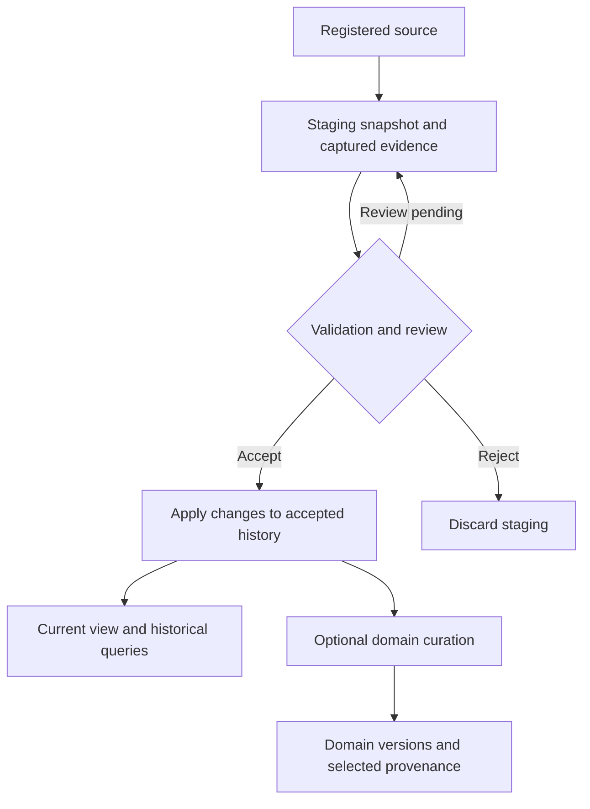

# Metadata, source history and provenance

UTT captures heterogeneous source data in `mirror` and optionally curates it into
`utt` domain tables. Original attributes and geometry remain available; curation
harmonizes the data needed by an application. CityGML/3DCityDB provides an
interoperability interface for suitable data.

This guide describes the current fresh-initialization model. Editing initialization
SQL does not update an existing database. [UTTDB](uttdb.md) explains practical
workflows; the [glossary](glossary.md) defines terms. The
[database reference](database-reference.md) inventories objects, callers and maintenance
responsibilities. Routine
comments document detailed interfaces, and [AGENTS.md](../AGENTS.md) contains
implementation rules.

## Storage responsibilities

Five shared metadata tables connect source identity, accepted observations and
selected contributions. Source/import metadata lives in `mirror`; domain metadata
lives in `utt`. Cross-schema routines live in `utt_pkg`.

| Table | Responsibility |
|---|---|
| `mirror.registry` | Dataset/layer identity `(source_name, layer_name)`, access/location, coverage, ownership, published metadata and ingestion settings. External-file datasets also keep their accepted reference versions here. |
| `mirror.import` | One ingestion attempt: captured location, coverage, revision/schema evidence, validation results and status (`staged`, `accepted`, `rejected`, `failed`). Acceptance makes the record immutable. |
| `mirror.source_columns` | Distinct immutable source-column sets needed to interpret history; imports reuse a matching `structure_version` rather than copying definitions each time. |
| `utt.curation_mapping` | Candidate contributions: source registration/columns, matching ID, target attribute group, priority, approved SQL rule and activation. |
| `utt.curation_provenance` | Actual selected contributions: target version, mapping, exact source version/key, accepted input, observation time and selection reason. |

Registry references use immutable `row_id` values. A database-row dataset has one
registration; an external-file dataset can have several reference versions with
the same logical identity. Retirement leaves referenced history available.

Each database-row dataset has these objects, using a unique registry-controlled base:

| Object | Responsibility |
|---|---|
| `mirror.<base>_source` | Read-only foreign table or adapter exposing the source. |
| `mirror.<base>_staging` | Temporary snapshot for comparison and review; original source columns without UTT version metadata. |
| `mirror.<base>_stored` | Accepted source history: original state plus immutable `row_id`, stable-key representation `utt_key`, `utt_txn` and creating `import_id`. |
| `mirror.<base>` | Read-only current view over `_stored`; no duplicate storage. |

Curated city, district, block, plot, building and address tables hold typed domain
state, stable logical IDs, immutable version IDs and system time. Spatial relation
tables connect endpoint versions rather than repeatable logical IDs.

## From source to accepted history



Ingestion compares explicitly configured stable keys and complete source state,
including geometry. New objects are inserted; changed objects receive replacement
versions; unchanged objects stay untouched. Valid snapshots pass automatically when
safety thresholds pass unless manual review was requested. Otherwise the snapshot
remains available for inspection. Manual acceptance publishes that same snapshot
without refetching and can override thresholds, but not integrity validation.

Each dataset has at most one pending snapshot. `mirror.import` retains its evidence
through acceptance or rejection; staging disappears after either decision. Accepted
imports remain permanently, including successful no-op imports. Failed or pending
attempts leave accepted state untouched. Delayed acceptance revalidates against
current history; version changes, import evidence and registry summaries publish
in one transaction.

Mirror treats each row import as a full snapshot of its registered source scope.
Acceptance closes current source versions absent from that snapshot; historical rows
remain. Count thresholds hold unusually changed or empty updates for review before
publication. Rejection and failed reads leave accepted state untouched. Partial/delta
imports are unsupported. Source withdrawal records disappearance from the source,
not demolition or automatic retirement of curated state.

Accepted revision evidence is separate from the latest advertised revision and is
NULL without a reliable association to the captured data. Reusable source-column definitions preserve
column structure and meanings: a historical NULL can mean that a column did not
exist yet. Additions/removals are supported; incompatible type/collation or meaning
changes require a new column or dataset instead of rewriting history.

Published metadata retains its original language and wording. Absent values remain
NULL; ownership and license rights are not inferred. Database-row registry metadata
is current descriptive metadata, not an archive of every service response.

### Native files

External files such as NetCDF remain outside PostgreSQL. Their accepted versions
live directly in `mirror.registry`, with path/namespace, format, size,
checksum/algorithm, `utt_txn` and creating import. A path is a location, not dataset
identity. Registration needs neither a parser nor geometry; curation of native
contents requires an approved format-specific reader and exact-file provenance.

The same import lifecycle stages a manifest instead of decoded rows. Acceptance
rechecks readability and checksums against the pinned file. Changed bytes or
registered state, such as path/format, create a replacement reference version;
an unchanged reference records only an import. Missing files fail ingestion.

For example, logical dataset `temperature` can refer to `temperature-v1.nc` at T1
and `temperature-v2.nc` at T2. The registry retains both references. Historical
byte access depends on keeping both files unchanged at version-specific paths;
checksums cannot restore lost bytes. File retention/backups are separate duties,
and database rollback cannot undo filesystem changes. Rejection removes staging,
not the source file.

## One system-time axis

`utt_txn tstzrange` records **when UTT considered a state current**, not when an
object changed in the real world. Every version has an immutable `row_id` and a
repeatable logical identity. Nonempty half-open ranges `[start, end)` have finite
openings and unbounded endings for current versions. GiST exclusion constraints
prevent overlapping versions of the same logical object.

A content change closes the old version and opens its replacement at one timestamp;
historical attributes remain intact. The creating `import_id` identifies the
accepted input for a source version. Later unchanged imports remain visible in
import history without changing that version or its creating import.

Source dates remain ordinary attributes, with no generic `source_valid` or inferred
valid-time ranges. In the Berlin mappings, block `source_date` preserves `datum`,
plot `source_date` preserves `beg`, and address `address_date` preserves `aufn_dt`.
Changed mapped dates count as changed state even when the date moves backwards.
Advertised revisions and provenance changes alone do not create domain versions.

## Curation and selected origins

Mappings describe candidate contributions to **atomic attribute groups**. For
example, geometry and function may be selected together while height has independent
candidates. Active groups are equal or disjoint. Lower numeric priority wins,
followed by mapping ID and stable source key. Priority expresses preference, not
accuracy. Mapping definitions are immutable except for activation; revised behavior
has a new approved SQL rule identity rather than executable SQL in metadata.

| Rule family | Eligibility and behavior |
|---|---|
| `berlin_<entity>_v1` | Established Berlin transformations; usable geometry required, descriptive values may be NULL. |
| `direct_<entity>_v1` | Named source/target column pairs cast to target types; every group member must be non-NULL. |
| `sum_<entity>_v1` | Numeric sums by explicit matching ID; only complete contributors participate, and every contributor is retained in provenance. |

Columns/types, units, code meanings, CRS and matching IDs must be compatible;
automatic CRS conversion is not inferred. If required columns disappear from the
latest accepted schema, the mapping becomes ineligible even if physical history
still contains those columns. Without eligible replacements, existing state and
its exact former origins remain. Clearing values, retirement, splits, merges and
cross-source identity changes need explicit domain semantics.

| Curation result | Stored effect |
|---|---|
| Managed content changed | Close the current domain version, insert its replacement, and record every group, including carried origins. |
| Same content, different selected origins | Keep the domain version and append complete replacement observations for changed groups. |
| Same content and selection | No new domain versions or provenance observations. |

Provenance stores one selected contributor per source record/group observation,
not per attribute or rejected candidate. Each contributor identifies its immutable
mapping, exact source version, named stable key, accepted import and selection
reason. Carried origins retain their original accepted input even when that input
is no longer current. Every observation contains the full selected contributor set.

`target_table regclass` and `target_row_id` identify the target version without
per-entity provenance columns. This is a validated generic reference, not a target
foreign key: the trigger checks mapping/table agreement, locks/checks the row and
requires observation time within its system-time range. History protection prevents
target deletion/truncation. Per-source provenance partitions enforce genuine
source-history foreign keys; native-file contributors reference registry versions.

Changing group boundaries means deactivating former mappings and installing
replacements in one transaction, then re-curating. Eligible replacement groups must
fully cover each former group; partial regrouping is rejected. New observations
supersede overlapping groups without reinterpreting historical definitions.

Mapping edits and domain/relation writes share an advisory transaction lock.
Curation also holds an exclusive lock on `mirror.registry` while selecting accepted
inputs: existing writers finish first, new publications wait, and plain readers
remain allowed. Entity changes and provenance commit together through restricted
curation routines rather than direct pipeline writes.

## Current and historical queries

```sql
SELECT * FROM utt.building_current;
SELECT * FROM utt_pkg.building_at(TIMESTAMPTZ '2026-10-01 12:00:00+00');
SELECT * FROM utt_pkg.provenance_at(
  'building', TIMESTAMPTZ '2026-10-01 12:00:00+00');
```

As-of provenance selects the target version at the requested time and the latest
complete observation for each group using historical mapping definitions. Keeping
multiple contributors separate from flat entity rows avoids multiplying counts or
areas in joins.

### Spatial relations

The three relation tables derive temporal context from overlapping endpoint
`utt_txn` ranges, with no additional time axis. Relation curation backfills missed
historical pairs and inserts only absent pairs. Intersection fractions are rounded
to three decimals, then must exceed 0.02. It runs explicitly after endpoint curation;
entity writes do not update relation storage automatically.

```sql
SELECT utt_pkg.curate_relation('building_plot');
SELECT * FROM utt.relation_bldg_plot_current;
SELECT * FROM utt_pkg.relation_at(
  'building_plot', TIMESTAMPTZ '2026-10-01 12:00:00+00');
```

History begins at the first accepted observation. It preserves observed state and
selected origins, not unseen remote changes, every service response or byte-exact
source payloads without archives. [UTTDB](uttdb.md#persistence) links the rollback-only
SQL checks; these run against disposable initialized databases.
