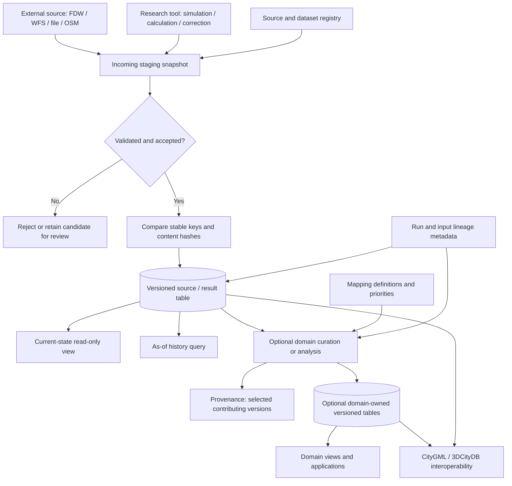
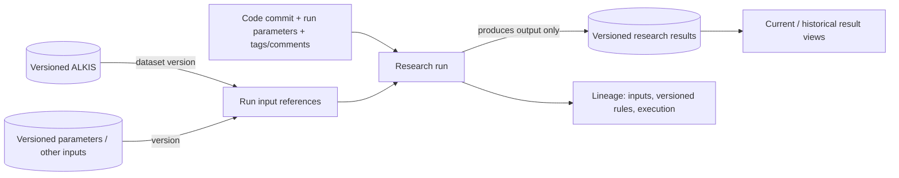

# UTT metadata model: source history, domain curation and lineage

**Status:** Proposed architecture for incremental implementation, not a statement of what is already deployed. This supersedes the earlier design's assumption that all sources must be curated into one common urban model. Existing `mirror.registry`, `utt` entity tables and `utt_pkg` routines are starting points, not an instruction to rename or migrate them immediately.

## 1. Purpose and principles

UTT is a **continuously operating, version-aware infrastructure for heterogeneous urban datasets**, not an attempt to finish a universal urban data model. The priority is to register sources early and preserve the changes observed thereafter, so future research can use attributes not anticipated today. Domain experts own domain models; building energy is the initial curated domain. Other domains do not need a curated model until an application and maintainers justify one.

- **Capture first, model when needed.** Preserve source columns, geometries and observed changes without requiring semantic translation on import.
- **One versioning mechanism for external and internal data.** A calculation, simulation or manual research contribution can register a dataset just as ALKIS, OSM or WFS can.
- **Reference inputs; do not copy them into outputs.** Store generated values and the keys needed to relate them to inputs, with run-level parameters and references to exact input versions. Deliberate materializations must be declared separately.
- **Keep SQL/PostGIS approachable.** Current data appears as ordinary read-only views; historical data remains queryable. Generic metadata stays small, while mapping rules remain understandable SQL.
- **Distinguish time meanings.** The mirror records *when UTT knew a source version* (`utt_txn`). Optional domain models can additionally represent *when a condition held in the world* (`source_valid`). Source publication dates and simulated scenario years are neither of these axes.
- **No claims of unobserved history.** Versioning begins with the first accepted snapshot. Changes between observations cannot be reconstructed unless the source itself provides them.

## 2. Architecture and data flow



**Persistent source data:** one versioned physical table per registered layer/dataset, storing current and prior observed records. A normal current-state view does **not** duplicate storage. A staging copy exists only during an import or review; externally retained input files can serve as the reproducible incoming snapshot. Change detection is an operation, not another permanent data layer.

Typical interface (illustrative names; actual schema allocation may differ):

| Interface | Responsibility |
|---|---|
| `mirror.registry` | Registered datasets/layers, identities, locations, extents, metadata, update configuration |
| `mirror.<layer>_versions` | Protected physical table: source columns plus transaction-time/version metadata |
| `mirror.<layer>` | Read-only view of current rows (`upper_inf(utt_txn)`) |
| `mirror.<layer>_at(t)` | Function exposing rows known at system time `t` |
| `utt.<domain_table>` | Optional curated domain state, potentially bi-temporal |
| `citydb` | CityGML/3DCityDB representation, import and export; not the universal authoritative data store |

Views are normally optimized into the underlying query; a **partial index on current rows** and appropriate keys/spatial indexes prevent routine requests from scanning history unnecessarily. Restrict modification privileges on both views and physical tables: simple PostgreSQL views can otherwise be writable.

## 3. Registered sources and observed history

Registration should identify a **dataset/layer**, not merely a service endpoint. Keep the existing composite identity `(source_name, layer_name)` until a deliberate migration; use an immutable dataset identifier internally if it helps references. Reuse location, coverage and descriptive metadata rather than copying them into every mapping.

A minimal metadata structure is:

| Record | Essential content |
|---|---|
| Source/dataset registry | Identity, origin, type (external or generated), physical table/view, coverage, ownership, schema and license information |
| Accepted import/version | Immutable `import_id`, dataset, accepted-at time, reliably associated source revision (nullable), coverage/completeness, schema version and status |
| Versioned feature row | Stable **source-scoped** feature key, original source attributes/geometry, `utt_txn` half-open system-time range, creating `import_id` and optionally content hash |

`imported_at` can remain a convenient **latest accepted import** field on the registry, but is not a substitute for an immutable accepted-import history. `data_revision_at` is the revision of *accepted* data when known, never simply the latest revision advertised by a service. Record registration time if useful operationally; it does not establish valid time.

### Import algorithm

```mermaid
sequenceDiagram
    participant S as Incoming staging
    participant I as Ingestion / compare
    participant V as Versioned table
    participant R as Import registry
    S->>I: Accepted complete snapshot or declared delta
    I->>V: Match by stable, source-scoped feature key
    I->>I: Compare normalized values, geometry and schema
    alt New feature
        I->>V: Insert open-ended version
    else Changed feature
        I->>V: Close old utt_txn at T; insert new version at T
    else Unchanged feature
        Note over V: Leave unchanged (no new version)
    end
    opt Confirmed deletion in complete authoritative coverage
        I->>V: Close prior version at T, no replacement
    end
    I->>R: Commit accepted import and metadata atomically
```

Use the **same database timestamp `T`** for closing and opening versions in a successful import. Failed/rejected imports must not change the accepted state. Record stable identifiers and schema revisions; never use `ctid` as an identity. Keep source attributes unchanged apart from necessary technical adaptations. Schema additions are straightforward; removals, renames, altered types/units and changed semantics need explicit schema evolution handling. In particular, old `NULL` values may mean *column not yet present* rather than *known missing*; keep versioned schema metadata, and preserve originals when feasible.

**Deletion safety:** an absent key means deletion only for an authoritative **complete** snapshot of the relevant coverage. Partial WFS extracts, incremental feeds, failed imports or changes in extent cannot imply deletion. Closing `utt_txn` means *UTT stopped considering the record current*, not that a building was demolished.

Import history preserves **observed states**, not every unobserved remote change or every intermediate advertised revision. A full raw snapshot/file archive is optional but useful when byte-exact reconstruction matters; feature history plus schema/import metadata supports reconstruction of the accepted logical data state.

## 4. Temporal model and access

Mirror source rows use **one mandatory time axis**: `utt_txn tstzrange`, representing UTT's knowledge interval, with non-overlapping half-open `[from, to)` intervals for each dataset-feature identity. A currently known feature has an unbounded upper end. Domain-owned tables may also have `source_valid tstzrange` for real-world validity, following the existing UTT temporal model. Unknown validity remains `NULL`; do not infer it from ingestion times.

```sql
-- Normal current-state view; illustrative only.
CREATE VIEW mirror.buildings AS
SELECT source_feature_id, geom, building_function
FROM mirror.buildings_versions
WHERE upper_inf(utt_txn);

-- Historical source state known to UTT at a selected time.
SELECT * FROM mirror.buildings_versions
WHERE utt_txn @> TIMESTAMPTZ '2026-10-01 12:00:00+00';

-- Optional bi-temporal domain state: knowledge then about reality at a date.
SELECT * FROM utt.building
WHERE utt_txn @> TIMESTAMPTZ '2026-10-01 12:00:00+00'
  AND source_valid @> TIMESTAMPTZ '2025-06-01 00:00:00+00';
```

A view exposes a fixed current state; use a function for parameterized as-of queries. Enforce correct non-overlapping intervals and index current and historical access paths. Source revisions, run times, modelled years and import times are descriptive metadata/events, not additional implicit validity axes.

## 5. Domain curation: optional, explicit, reproducible

Curation is **not mandatory on ingestion**. A domain that needs harmonized entities can define its own tables, column meanings, matching logic and transformations. The existing building-energy `utt` entities and six curation routines remain useful; new domains require domain maintainers, not speculative extensions of a universal schema.

Retain the useful parts of the proposed `utt.curation_mapping` design:

- One mapping revision defines a candidate source for a target **attribute or atomic attribute group**, with source columns, target columns, approved `utt_pkg` rule and priority; lower priority numbers win.
- Candidates for a group must address the **same complete group**. Reject partial overlap, ambiguous matching and unverified type/unit equivalence. Separate attributes that need independent fallback.
- Apply documented identifier or spatial matching; use registry extents to warn about impossible or partial regional coverage, without assuming a bounding extent guarantees completeness.
- Mapping revisions used historically must remain identifiable; changing semantics creates a new revision. Do not execute arbitrary SQL supplied as metadata.
- Only write a new domain data version if its **state content changes**. A changed selected contributor with identical output can instead record a new provenance observation. Never version merely because an unchanged source was refreshed.

`utt.curation_provenance` can preserve **which accepted source feature version(s), mapping revision and rule** contributed to one target-version/group observation. Store stable keys plus import/version identity, not input values again. Keep one contribution per selected group/source record (multiple for aggregation), not one per copied attribute. When a selection changes, record a full replacement observation for that group; old selection records remain historically inspectable. Persist explicit selection reasons; don't pretend to retain all rejected candidates.

## 6. Research results: datasets, runs and lineage

**Research outputs are another registered dataset**, using the same versioned ingestion path. However, **runs/scenarios and transaction-time versions have different meanings**: outputs for different scenarios, simulated years, parameter sets or model versions must not automatically supersede each other. Define logical dataset/scenario identity before comparing feature versions.

For this reason, introduce minimal reusable run-level metadata, which the earlier curation-only specification had deferred:

| Record | Stores |
|---|---|
| Dataset | Registered result type and stable logical identity, including scenario where appropriate |
| Run | `run_id`, tool/model name and immutable version or code commit, execution time/status, parameters, **tags, comments**, author/maintainer when appropriate |
| Run input | `run_id` + referenced dataset **version/import or historical as-of state**, selection/query or extent and role in calculation |
| Result rows | Output values, identifiers to match entities, `run_id`, source-version/time metadata as needed; **no repeated input attributes** |



A 2050 scenario and a present-day baseline coexist; they are not successive historical versions of one output. Recomputing a genuinely identical logical target may create a replacement transaction-time version. Retain input selection logic and exactly which accepted dataset versions were read; if a run depends on records observed at different times, a single global timestamp is insufficient. References must be durable, even if a source registration is retired. Store parameters once per run and immutable/versioned model identifiers. Do **not** repeat building age, area, geometry and similar input attributes millions of times in output tables. Caches for performance are exceptional, explicit and rebuildable.

## 7. Practical boundaries and implementation order

1. **Make source registration and import history real first.** Retain current registry behavior where possible, add accepted-import identity, stage and compare one complete source, store versions in one protected table and provide the current-state view.
2. **Prove history access.** Test inserts, updates, confirmed deletions, no-op refreshes, failed imports, schema additions, incomplete coverage, read-only access and as-of queries. Check actual storage and query plans on a representative large source.
3. **Generalize one importer path.** Reuse the mechanism for other registered external sources; don't build a universal parser or a new execution platform unnecessarily.
4. **Register one research result.** Add minimal run, tag/comment and exact input-version references; verify that outputs store no duplicated inputs and that reruns/scenarios are distinguishable.
5. **Adapt building-energy curation.** Link its existing bi-temporal target versions and mapping-group provenance to persistent source feature/import versions. Extend to other domains only with a real application and domain expert.
6. **Expose inspection in SQL and an eventual admin interface.** Show import history, source differences, snapshot-at-time and run lineage. Keep the physical historical tables protected; the views are the everyday interface.

**Deliberately out of scope:** a universal curated attribute catalogue, automatic harmonization across all urban domains, assumption that CityGML can represent every analytical object, an invented rule language, speculative domain models and a complete workflow/orchestration system. CityGML exchange remains a supported adapter over appropriate data, not a mandatory duplicate repository for every research attribute.

**Outcome:** UTT can operate and accumulate source history immediately, while modelling, scientific methods and domain semantics evolve independently. Its enduring common core is dataset identity, version-aware ingestion, history, provenance and reproducible lineage—not a permanently unfinished representation of the entire city.
