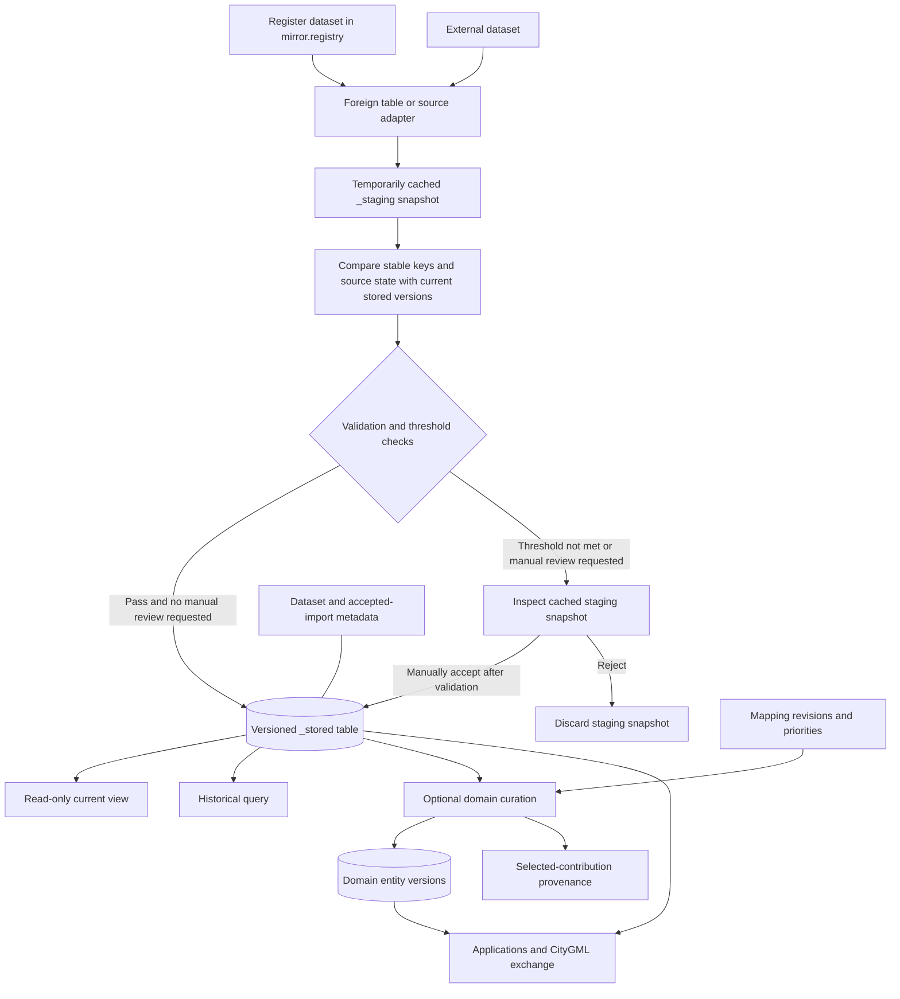
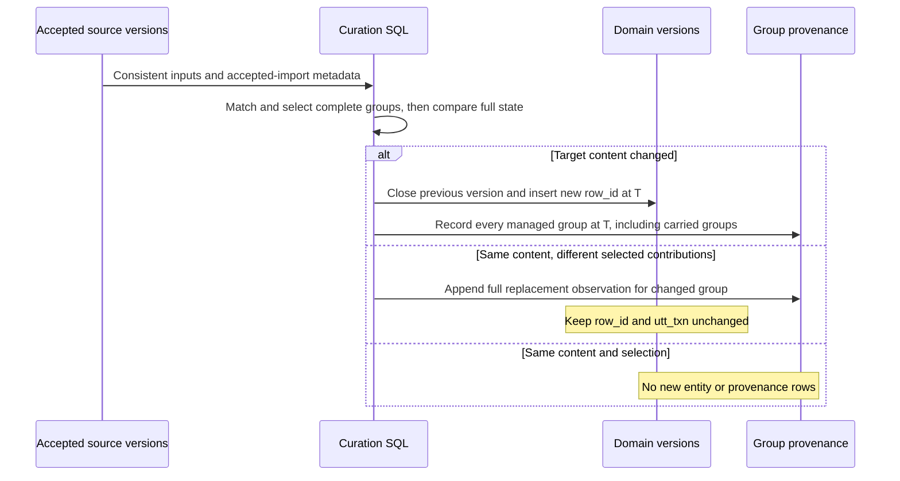

# UTT metadata model: source history, domain curation and provenance

**Status:** This document specifies required changes
from the current implementation to the new metadata model; it is not a description
of the deployed database or an optional alternative workflow. Its requirements
take precedence over current SQL interfaces. Implementation has not been performed by writing this document. Target fresh
initialization: this prototype does not require preserving existing database
contents. Do not write migration SQL or compatibility code for existing databases
until the user explicitly requests that phase. Prefer focused changes to existing
files to keep contributor history readable.

See the [metadata dictionary](metadata_dictionary.md) for definitions of the main
concepts and terms.

## 1. Capture first, curate when needed

UTT is a continuously operating infrastructure for heterogeneous urban datasets.
Its common core is dataset identity, observed history and traceable use of data.
It does not require every source to fit one universal city model before becoming
useful. Building energy is the initial curated domain; further domain models need
a concrete application and maintainers who understand their meaning.

The current scope is ingestion and history for external sources, plus optional
domain curation. Preserve original attributes and geometry, then harmonize only
where needed. Our own analysis outputs could later be registered and handled like
external sources; any additional execution or input-lineage metadata is deferred.
Keep processing primarily in PostgreSQL/PostGIS, with readable SQL and small
metadata structures. CityGML/3DCityDB remains an interoperability interface for
suitable data, rather than a compulsory copy of every research attribute.



For sources represented as database rows, store one physical version table per
registered dataset/layer. A current view
filters that table; it does not duplicate storage. The staging snapshot is a
temporary cache for both import and inspection; there is no separate review table
or review candidate. Change detection is an operation, not another permanent data
layer.

For each registered layer, the required ingestion sequence is:

1. Register its identity and source access in `mirror.registry`.
2. Expose the original source through a read-only foreign table where supported.
   File/raster sources may use a source adapter instead; they follow
   the same staging and acceptance contract.
3. Cache the incoming source in `mirror.<layer>_staging`, preserving the columns,
   types and values exposed by that source interface, including geometry. Do not
   curate, filter or add version columns to this snapshot. Keep import/revision
   evidence separately from source columns. Any unavoidable source-interface type
   adaptation must be documented; this is logical fidelity, not a byte-exact copy
   of a remote format. Declared partial/delta deliveries retain their stated scope.
4. Compare the cached snapshot with current versions in `mirror.<layer>_stored`
   by stable source keys and complete source state. Determine new, changed,
   unchanged and, where justified, withdrawn objects. On first acceptance, every
   incoming object is new. This comparison produces the incremental change set;
   it does not require another permanent table.
5. After automatic or manual acceptance, apply only the detected changes to
   `_stored`. Insert new versions with `utt_txn = [T, infinity)`. For a changed
   known object, terminate the old version at T and insert its replacement at the
   same T. Keep the old row and its immutable identity. Leave unchanged objects
   untouched; close withdrawals only under the completeness rules below.

`_stored` therefore becomes the persistent history table, rather than a replaceable
current snapshot. It preserves the source columns and values, with additional
UTT-managed columns: an immutable version `row_id`, `utt_txn tstzrange` and the
creating `import_id`; a content hash is optional. `utt_txn` is a time range, not a
single timestamp. Resolve collisions with source column names explicitly without
silently overwriting or dropping original fields. Schema evolution follows the
historical interpretation rules below.

Expose current source data through a normal, non-materialized, read-only view over
`_stored`, selecting the source columns where `upper_inf(utt_txn)`. The view adds
no stored copy and reflects each committed acceptance automatically. Technical
version metadata remains available from `_stored` for history and lineage queries.
Manual acceptance publishes the inspected staging contents, without fetching the source
again. Serialize publication per dataset and validate or recompute its change set
against the then-current `_stored` state before writing, so a delayed acceptance
cannot apply an outdated comparison.

Automatically accept a validated snapshot when the import safety thresholds pass,
unless manual review was requested. If a threshold is not met, or manual review
was requested, retain the same staging snapshot for inspection and explicit manual
acceptance or rejection. Manual acceptance can override threshold checks, but must
still satisfy structural and integrity validation. Remove the cache after successful
publication or explicit rejection; keep pending snapshots until a decision is made.

### Native files registered by reference

Registration must also support files that remain outside PostgreSQL, such as
NetCDF and other specialist formats. Register their dataset identity in
`mirror.registry` with an explicit storage mode: database rows or external files.
External-file registration does not require a foreign table, geometry, raster
conversion, a PostGIS representation or domain curation. Consumers read the native
file using its server-side path; PostgreSQL stores its identity and version history.

Keep pure-file registration and its accepted version history directly in
`mirror.registry`; do not introduce a separate file-tracking table. Each accepted
file registration version contains an immutable `row_id`, server-side path and
namespace, native format, byte size, content checksum with its algorithm,
`utt_txn` and creating `import_id`. The repeatable `(source_name, layer_name)`
identifies the logical file dataset across versions; its path is a location, not
its identity. Register independently versioned files as separate dataset/layer
entries rather than embedding a file list or history in JSON.

The registry can therefore contain several historical rows for one pure-file
identity. Replace its current composite primary-key assumption with immutable
registry-row identity and non-overlapping `utt_txn` ranges per pure-file identity.
Database-row registrations remain single entries; do not impose temporal metadata
on them without a concrete use. Enforce storage-mode consistency for each logical
identity and prevent duplicate database-row registrations. References to a registry
row must identify its immutable `row_id`; do not treat the repeatable logical key
as unique across file history. Imports and mappings retain the exact referenced
registration, while refresh resolves the current registration by logical identity.
An initial registration may exist before acceptance without claiming accepted file
history; only acceptance opens its first `utt_txn`, and pending refresh evidence
stays in staging rather than overwriting the accepted registry row.

Paths must identify the server or mount namespace in which they resolve; for
container access use the mounted path, for example
`/source-files/climate/run-001.nc`.

Use the same `mirror.import` lifecycle and acceptance boundary as row-based
sources. For external files, stage a manifest of stable file keys, paths, formats,
sizes and checksums rather than parsing their contents into source rows. Validate
that each referenced file is readable and that its bytes match the manifest.
Manual review inspects that manifest and the same pinned files; it must not
silently accept newer bytes at a reused path. Preserve the staged files unchanged
until acceptance or rejection and revalidate their checksums before publication.
A minimal file reader/checksummer may supply this evidence where PostgreSQL
cannot access the filesystem or format; acceptance and history remain in SQL.

On acceptance, compare each logical file dataset's checksum and registered state.
Changed bytes or a changed path/format create a replacement version; an unchanged
registration records a successful import without creating another file version.
Close the old `utt_txn` and open the new one at the same acceptance timestamp.
Enforce non-overlapping ranges per logical file dataset. File modification times alone
are not reliable change detection and do not establish source validity. Native
time coordinates and published temporal coverage remain source metadata, not
another UTT-managed time axis. A missing or unreadable file is an import failure,
not automatic withdrawal; withdrawal needs the same explicit completeness rules
as row-based sources.

Retain accepted files at immutable version-specific paths if historical bytes must
remain retrievable. Never overwrite a retained version's file. Database history
preserves references and checksums, not file contents: deleting or replacing files
can make historical versions unavailable, and a checksum cannot restore them.
Filesystem retention and backups must be managed separately; a database transaction
cannot roll back a filesystem change. Rejection removes the temporary manifest,
not the registered source files. A historical query returns the path and checksum
known at the requested system time, with byte retrieval depending on retention.

For example, accept logical file `temperature` at
`/source-files/climate/temperature-v1.nc` at T1, then changed bytes at
`/source-files/climate/temperature-v2.nc` at T2. Keep two reference versions with
`utt_txn = [T1, T2)` and `[T2, infinity)`, and retain both files for reproducibility.
No NetCDF variables need to become PostGIS columns. Registration and history work
without a parser; any later curation needs an explicit format-specific reader and
must reference the exact accepted file version.

## 2. Dataset identity and accepted source history

Register a dataset/layer, not just a service endpoint. Keep `(source_name, layer_name)` as repeatable logical registry identity in the
target implementation; pure-file versions have distinct immutable registry row IDs. A referenced
registration must not be deleted or repurposed; retire it and register a distinct
source when its identity changes. Historical references remain usable.

| Record | Responsibility |
|---|---|
| Dataset registry | Identity, source origin, location, table/view, coverage, ownership, update configuration and published metadata |
| Accepted import | Immutable `import_id`, dataset, acceptance time, reliably associated revision or NULL, coverage/completeness and schema revision |
| External-file registry version | Repeatable logical dataset identity, immutable registry `row_id`, server-side path, format, size, checksum, `utt_txn` and creating `import_id` |
| Feature version | Immutable version identity, stable source-scoped key, original state, `utt_txn`, creating `import_id` and optional content hash |
| Schema revision | Meaning and structure needed to interpret the accepted historical rows |

`imported_at` may summarize the latest successful acceptance on the registry.
`data_revision_at` means the revision reliably associated with that accepted data,
never merely the latest advertised revision. Capture revision evidence with the
cached staging snapshot and validate it during delayed acceptance. If the association
cannot be established, store NULL; a later metadata response cannot establish it.
Registration time may be retained for operations; it does not date real-world changes.

Acceptance compares stable keys and all source state, including geometry. Insert
new objects, close and replace changed versions, and leave unchanged versions
alone. A deterministic hash is optional; it must cover the complete state and
exclude UTT-generated metadata. Never use physical row positions such as `ctid`
as identity. Technical normalization must be documented rather than silently
changing source meaning.

Use one database timestamp for all version boundaries in an import. Publish rows,
accepted-import metadata and registry summaries atomically. Failed or pending
imports leave accepted state untouched. A successful unchanged refresh can record
an accepted import without creating feature versions: the accepted state includes
the feature versions still current at that acceptance.

**Absence means withdrawal only under declared delivery semantics.** A complete,
authoritative inventory can justify closing missing features within its verified
coverage. Partial extracts, incremental deliveries, changed extents and failed or
unexpectedly empty imports cannot establish deletion. Explicit deletion events
require source-specific handling. Closing system time records a change in UTT's
knowledge, not a demolition date.

Keep schema history explicit. Additions, removals, renames, type/unit changes and
changed meanings must remain interpretable. A historical NULL may mean “column
not yet present,” rather than “known missing.” Preserve originals where feasible.
History begins at the first accepted observation; it cannot recover unseen remote
changes. Logical state reconstruction is the goal; byte-exact reproduction also
requires an optional original-file/snapshot archive. For external-file sources,
retention of each referenced native file is required to retrieve its historical bytes.

## 3. Time: one UTT-managed axis

Use `utt_txn tstzrange` as the only general temporal axis for both mirror and
curated domain history. It records when UTT considered a version current, not when
an object changed in the real world. Continuous operation improves observed history
without removing that distinction. Do not introduce a generic `source_valid`
column, inferred validity ranges or associated overlap constraints.

Each logical object has a stable, dataset-scoped key; each stored version has an
immutable `row_id`. Ranges are nonempty and half-open `[start, end)`, with an
unbounded upper end for current versions. Enforce non-overlapping `utt_txn` ranges
per stable identity using GiST exclusion constraints. A content change closes the
old version and opens its replacement at the same database timestamp.

Keep source dates such as `datum`, `beg` and `aufn_dt` intact as ordinary attributes.
A changed date participates in source-content comparison like any other changed
value. Domain curation compares every managed attribute, including dates included
by its mappings. Do not duplicate dates into a second time axis or reject changed
content merely because its source date is older. Document source meanings rather
than assuming a date describes real-world validity.

Dataset revision dates advertised outside feature rows belong in accepted-import
metadata. For example, data accepted today may report yesterday's dataset revision:
store today as `accepted_at` and yesterday as `data_revision_at` in
`mirror.import`, if reliably associated. The creating `import_id` links each
new feature version to that evidence. Unchanged feature versions retain their
creating import; later unchanged acceptances remain visible in import history.
Neither timestamp claims when an individual real-world object changed.

Import/revision metadata and provenance changes alone do not version domain data.
Source date attributes do count when they are part of the managed state.
Splits, merges and
cross-source identity changes require explicit domain decisions. Derived spatial
relations reference immutable endpoint versions and derive temporal context from
them without another stored time axis.

## 4. Optional domain mappings and selected origins

`utt.curation_mapping` describes candidate contributions; `utt.curation_provenance`
records the contributions actually selected. Keep entity data in domain tables
and approved cross-schema rules in `utt_pkg`.

| Mapping revision | Selected-contribution observation |
|---|---|
| `mapping_id`, source registration, source columns | Exact mapping revision and target entity `row_id` |
| Target table and attribute group | Stable source-record key and exact source feature version |
| Priority, approved rule identifier, active flag | Accepted input import, observation time and factual selection reason |

**Atomic groups are selected together.** For example, geometry and function may
come from one source, while height has independent candidates. Competing mappings
must address exactly the same set of target columns, regardless of array order.
Reject empty/duplicate members and partial overlap between active groups. Lower
priority numbers win; break remaining ties by mapping ID and stable source key.
Rules define matching, transformations, aggregation and whether NULL members make
the entire candidate ineligible. Losing-candidate changes do not version targets.

Validate columns and types against PostgreSQL catalogs; verify units, code meanings,
geometry references and matching assumptions. Exclude generated metadata such as
`row_id` and `utt_txn` from mapped state. Use approved SQL rules, not executable SQL
stored as metadata or a new JSON rule language. Referenced mapping definitions are
immutable except for activation; changed columns, priority, source or rule require
a new revision. Changed rule behavior requires a new durable rule identifier.

Provenance records one contribution per group/source record, not per attribute.
Aggregations can have several contributors. Use stable named keys, including small
JSONB composite keys where needed, and enforce real target/source-version foreign
keys, target/mapping agreement and duplicate prevention. For the initial six
entities, explicit nullable target FKs with exactly one populated retain ver01's
integrity boundary. Do not duplicate input values or every rejected candidate.



A contribution changes when its mapping or selected source feature version changes,
even if output values do not. An unchanged refresh creates neither a feature
version nor a provenance observation merely because its import ID is new. The
recorded import identifies the accepted input used when that origin was established
or changed; it is not a log of every verification.

Write the full contributor set for each observation together. Serialize observations
per target/group with strictly increasing timestamps. New entity versions receive
provenance for every populated managed group; old provenance stays with its old
`row_id`. Group-boundary changes require explicit re-curation and a full replacement
selection, never reinterpretation of earlier observations.

If no candidate remains, retain existing content and origin or fail as the rule
requires. Clearing a group or retiring an entity needs explicit withdrawal and
no-source provenance semantics. Source withdrawal does not automatically establish
real-world cessation. Read accepted inputs under publication-coordinated locking;
write entity changes and provenance in one transaction through narrow privileges.

## 5. Everyday access and historical inspection

Expose read-only current views and parameterized as-of queries/functions. Protect
both views and physical tables: simple PostgreSQL views may otherwise be writable.
Use current-row partial indexes, stable-key and spatial indexes, and suitable
historical indexes; verify query plans on representative data.

```sql
-- Current database knowledge, not necessarily valid in the world today.
SELECT * FROM utt.building WHERE upper_inf(utt_txn);

-- Source-derived building state known to UTT at a selected time.
SELECT * FROM utt.building
WHERE utt_txn @> TIMESTAMPTZ '2026-10-01 12:00:00+00';
```

For provenance at system time S, select the target version at S,
then its latest group observation at or before S, keeping all contributors from
that observation. Use historical mapping/group definitions, not today's activation
or grouping. Keep multi-record provenance separate or aggregate it explicitly so
joins do not accidentally multiply flat entity rows.

Preserve published metadata in its original language, leave absent values NULL
and do not infer license rights. Database-row registry descriptions are current metadata, not an archive of every
service response. Pure-file registry versions retain their accepted reference
state; this likewise does not archive every service response. Document units, CRS/elevation references,
NULL meanings, identifier scope and delivery completeness. Priority is preference,
not an accuracy guarantee; do not invent confidence values. Prefer column comments
and existing code lists over additional registries without a concrete need.

## 6. Required tables and per-source objects

These are target table names and responsibilities, not existing SQL definitions.
Create shared metadata tables once; create source objects per registered layer.
Keep source and import metadata in `mirror`, and domain curation metadata in `utt`. Cross-schema routines remain in `utt_pkg`.

### Shared metadata tables

| Table | Purpose and essential content |
|---|---|
| `mirror.registry` | Dataset identity `(source_name, layer_name)`, origin/access, stable-key definition, storage mode (database rows or external files), object names or file location, coverage, ownership, published metadata and update/threshold configuration. Pure-file datasets also store their accepted reference versions here, with immutable `row_id`, path/namespace, format, byte size, checksum/algorithm, `utt_txn` and creating accepted `import_id`. Latest accepted-import summaries may be retained here. |
| `mirror.import` | One row per ingestion attempt, identified by immutable `import_id` and dataset FK. Lifecycle status (`staged`, `accepted`, `rejected` or `failed`), staging relation while present, capture time, captured revision evidence, schema revision, scope/completeness, validation/threshold results and manual-review request. Acceptance adds `accepted_at`, reliably associated `data_revision_at` or NULL and acceptance method; the accepted row then becomes immutable. |
| `mirror.schema_revision` | Immutable dataset structure definitions, identified by dataset and schema revision. Store one row per column with its name, order, source type and documented meaning/units where available, so historical rows and old NULLs remain interpretable. |
| `utt.curation_mapping` | Immutable candidate mapping revisions: source registration, source columns, target table/group, priority, approved rule identifier and activation flag. |
| `utt.curation_provenance` | Selected contributions: target-version FK, mapping FK, exact source-version identity/key, accepted input `import_id`, group observation timestamp and selection reason. All contributors in one observation share its timestamp; source-version references must be validated against the registered history table. |

`mirror.import` combines staging metadata and accepted-import history. Keep at most
one pending staging snapshot per dataset. Its import row holds the evidence needed
for delayed acceptance without altering source columns. Publication marks that same
row `accepted` in the transaction that writes version changes and registry summaries;
`_stored.import_id` references an accepted row. No metadata is copied between import
tables. Capture time and acceptance time may differ; only acceptance opens
system-time versions.

Remove the temporary `_staging` table after acceptance or explicit rejection, and
clear its live staging-relation reference before finalizing the import row. Keep
accepted rows permanently, including successful no-op imports. Rejected or failed
attempts may remain for diagnostics, but are not accepted history and cannot be
referenced as the creating import of stored versions. A publication failure rolls
back accepted-state changes; recording a failed attempt requires separate error
handling after rollback. A threshold failure instead leaves the snapshot `staged`
for manual review. The import table therefore remains populated when idle; only
its pending subset becomes empty.

Referenced registry entries, schema definitions and accepted imports remain
available after retirement. Group observations live in provenance rather than a
separate execution registry; rules remain identifiable SQL rather than another
transformation catalogue. No permanent change-set table is required.

### Objects for each source dataset/layer

The per-layer objects below apply to database-row sources. External-file sources
use versioned `mirror.registry` entries and a temporary staging manifest instead; they need no
foreign table or per-layer `_stored` table. `mirror.import` references their staged
manifest while pending; a relational schema revision is not required for an opaque
native file. Record its format and available published structure metadata without
inventing a column schema. Current and as-of queries filter file reference history
in `mirror.registry` by logical dataset identity and `utt_txn`.

Use a registry-controlled unique layer base name; identical layer names from
different sources must not collide. Names below are illustrative.

| Object | Lifetime and responsibility |
|---|---|
| `mirror.<layer>_source` | Read-only foreign table where supported; otherwise a source adapter. Exposes original data and is not a persistent accepted copy. |
| `mirror.<layer>_staging` | Temporarily cached incoming rows, preserving source structure/content without UTT version columns. Retained while awaiting manual acceptance; removed after successful publication or rejection. |
| `mirror.<layer>_stored` | Persistent current and historical source rows: original columns plus immutable `row_id`, `utt_txn`, creating `import_id` and optional content hash. Apply detected changes rather than replacing history. |
| `mirror.<layer>` | Normal, non-materialized, read-only view selecting current source columns from `_stored` with `upper_inf(utt_txn)`. |

Optional curated `utt.<entity>` tables contain
managed state, a stable entity key, immutable `row_id` and `utt_txn`; they have no
generic `source_valid` column. Derived relation tables reference endpoint versions.
As-of functions/queries read history directly and require no additional tables.

## 7. Small implementation steps and honest guarantees

The following changes are required to move from the current implementation to this
model. In particular, replace separate `_review` tables and their review-candidate
lifecycle with the single temporarily cached staging snapshot described in section
1. Retain the threshold checks and manual-acceptance capability within that staging
workflow. Replace snapshot-only mirror storage with observed feature history and
accepted-import identities, and add the mappings and provenance specified above. These are implementation requirements, not claims of existing
functionality.

Remove the general `source_valid` axis and its constraints from the target entity
model and replace validity-derived curation rules with content-based system-time
versioning. Preserve original source dates as attributes. Review and update callers
together with the initialization SQL; existing database contents need not be
converted or preserved. This document changes no database.

1. Establish reliable accepted-revision capture and immutable import identity for
   one source. Preserve referenced registrations and schema meaning.
2. Version that source with protected history and a current view. Verify inserts,
   changes, no-op refreshes, confirmed withdrawals, failed imports, partial coverage,
   schema changes and historical reconstruction before generalizing ingestion.
3. Add external-file registration using the same import boundary. Verify changed
   bytes, unchanged refreshes, path changes, delayed acceptance, unreadable or
   replaced files, explicit withdrawal and historical retrieval without format
   conversion.
4. Validate mappings and adapt one domain routine, then the other five. Check
   atomic groups, fallback, temporal constraints, carried groups, selection-only
   changes, historical provenance and transaction consistency. Prefer rollback-only
   database checks where practical.
5. Expose SQL inspection and later an admin interface over the same boundaries.

This model preserves accepted observed states and selected origins. It does not
claim unobserved source history, every rejected candidate, historical service
metadata or byte-exact reproduction without archives. A universal attribute
catalogue, automatic harmonization of all domains, speculative domain models and
a complete execution platform remain outside scope. Existing interfaces and callers
must be reviewed when implementing these required replacements; this document
itself changes no database.
