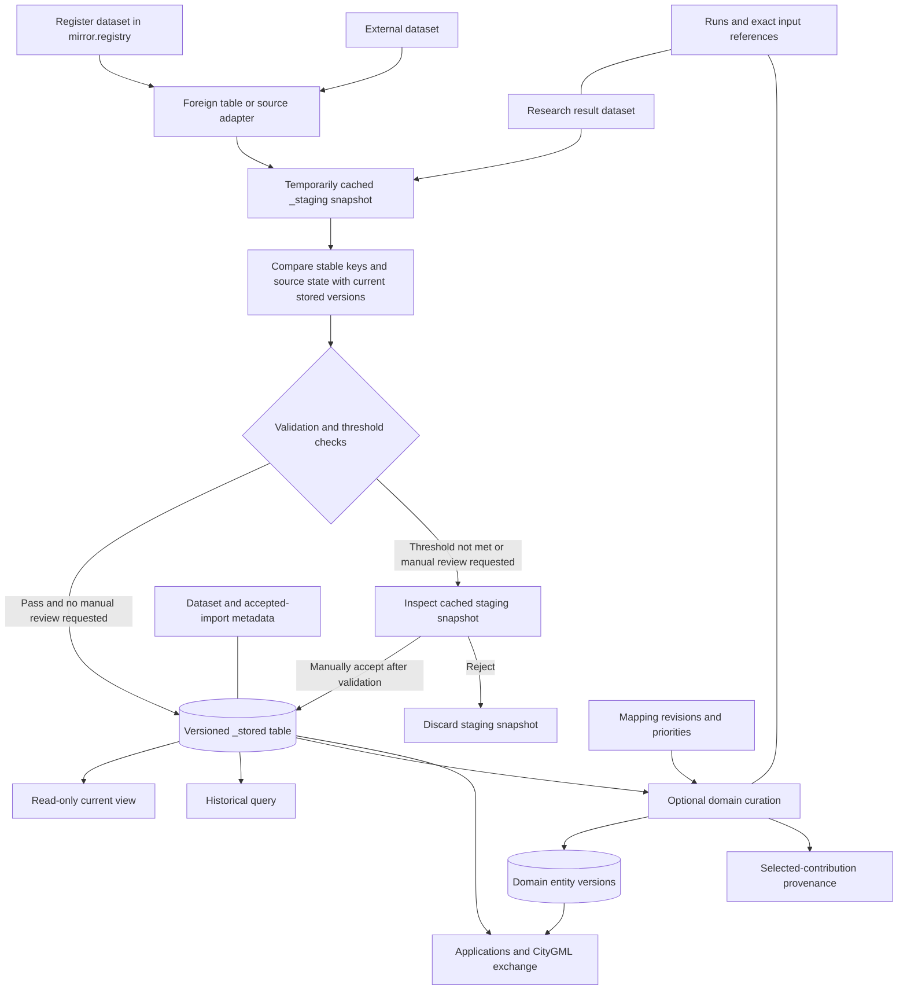
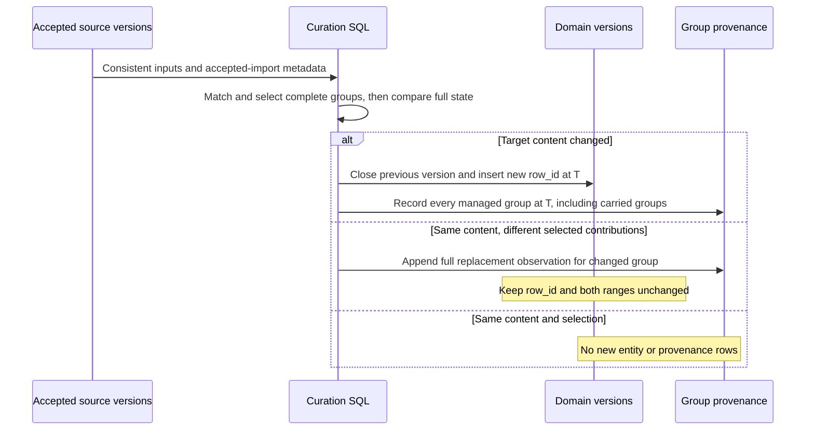
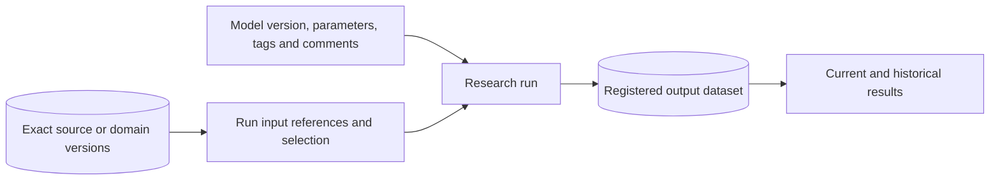

# UTT metadata model: observed history, domain curation and lineage

**Status:** Requested target design, combining [ver01](metadata_modelling_ver01.md)
and [ver02](metadata_modelling_ver02.md). This document specifies required changes
from the current implementation to the new metadata model; it is not a description
of the deployed database or an optional alternative workflow. Its requirements
take precedence over current SQL interfaces. Implementation and any live migration
are separate work and have not been performed by writing this document.

See the [metadata dictionary](metadata_dictionary.md) for definitions of the main
concepts and terms.

## 1. Capture first, curate when needed

UTT is a continuously operating infrastructure for heterogeneous urban datasets.
Its common core is dataset identity, observed history and traceable use of data.
It does not require every source to fit one universal city model before becoming
useful. Building energy is the initial curated domain; further domain models need
a concrete application and maintainers who understand their meaning.

External sources and internal research results use the same versioned ingestion
path. Preserve original attributes and geometry, then harmonize only where needed.
Keep processing primarily in PostgreSQL/PostGIS, with readable SQL and small
metadata structures. CityGML/3DCityDB remains an interoperability interface for
suitable data, rather than a compulsory copy of every research attribute.



Store one physical version table per registered dataset/layer. A current view
filters that table; it does not duplicate storage. The staging snapshot is a
temporary cache for both import and inspection; there is no separate review table
or review candidate. Change detection is an operation, not another permanent data
layer.

For each registered layer, the required ingestion sequence is:

1. Register its identity and source access in `mirror.registry`.
2. Expose the original source through a read-only foreign table where supported.
   File/raster and generated datasets may use a source adapter instead; they follow
   the same staging and acceptance contract.
3. Cache the incoming source in `mirror.<layer>_staging`, preserving the columns,
   types and values exposed by that source interface, including geometry. Do not
   curate, filter or add version columns to this snapshot. Keep import/revision
   evidence separately from source columns. Any unavoidable source-interface type
   adaptation must be documented; this is logical fidelity, not a byte-exact copy
   of a remote format. Declared partial/delta deliveries retain their stated scope.
4. Compare the cached snapshot with current versions in `mirror.<layer>_stored`
   by stable source keys and complete source state. Determine new, changed,
   unchanged and, where justified, withdrawn objects. On first acceptance, every
   incoming object is new. This comparison produces the incremental change set;
   it does not require another permanent table.
5. After automatic or manual acceptance, apply only the detected changes to
   `_stored`. Insert new versions with `utt_txn = [T, infinity)`. For a changed
   known object, terminate the old version at T and insert its replacement at the
   same T. Keep the old row and its immutable identity. Leave unchanged objects
   untouched; close withdrawals only under the completeness rules below.

`_stored` therefore becomes the persistent history table, rather than a replaceable
current snapshot. It preserves the source columns and values, with additional
UTT-managed columns: an immutable version `row_id`, `utt_txn tstzrange` and the
creating `import_id`; a content hash is optional. `utt_txn` is a time range, not a
single timestamp. Resolve collisions with source column names explicitly without
silently overwriting or dropping original fields. Schema evolution follows the
historical interpretation rules below.

Expose current source data through a normal, non-materialized, read-only view over
`_stored`, selecting the source columns where `upper_inf(utt_txn)`. The view adds
no stored copy and reflects each committed acceptance automatically. Technical
version metadata remains available from `_stored` for history and lineage queries.
Manual
acceptance publishes the inspected staging contents, without fetching the source
again. Serialize publication per dataset and validate or recompute its change set
against the then-current `_stored` state before writing, so a delayed acceptance
cannot apply an outdated comparison.

Automatically accept a validated snapshot when the import safety thresholds pass,
unless manual review was requested. If a threshold is not met, or manual review
was requested, retain the same staging snapshot for inspection and explicit manual
acceptance or rejection. Manual acceptance can override threshold checks, but must
still satisfy structural and integrity validation. Remove the cache after successful
publication or explicit rejection; keep pending snapshots until a decision is made.

## 2. Dataset identity and accepted source history

Register a dataset/layer, not just a service endpoint. Keep the composite registry
identity `(source_name, layer_name)` until a deliberate migration. A referenced
registration must not be deleted or repurposed; retire it and register a distinct
source when its identity changes. Historical references remain usable.

| Record | Responsibility |
|---|---|
| Dataset registry | Identity, external/generated origin, location, table/view, coverage, ownership, update configuration and published metadata |
| Accepted import | Immutable `import_id`, dataset, acceptance time, reliably associated revision or NULL, coverage/completeness and schema revision |
| Feature version | Immutable version identity, stable source-scoped key, original state, `utt_txn`, creating `import_id` and optional content hash |
| Schema revision | Meaning and structure needed to interpret the accepted historical rows |

`imported_at` may summarize the latest successful acceptance on the registry.
`data_revision_at` means the revision reliably associated with that accepted data,
never merely the latest advertised revision. Capture revision evidence with the
cached staging snapshot and validate it during delayed acceptance. If the association
cannot be established, store NULL; a later metadata response cannot establish it.
Registration time may be retained for operations, but is not valid time.

Acceptance compares stable keys and all source state, including geometry. Insert
new objects, close and replace changed versions, and leave unchanged versions
alone. A deterministic hash is optional; it must cover the complete state and
exclude UTT-generated metadata. Never use physical row positions such as `ctid`
as identity. Technical normalization must be documented rather than silently
changing source meaning.

Use one database timestamp for all version boundaries in an import. Publish rows,
accepted-import metadata and registry summaries atomically. Failed or pending
imports leave accepted state untouched. A successful unchanged refresh can record
an accepted import without creating feature versions: the accepted state includes
the feature versions still current at that acceptance.

**Absence means withdrawal only under declared delivery semantics.** A complete,
authoritative inventory can justify closing missing features within its verified
coverage. Partial extracts, incremental deliveries, changed extents and failed or
unexpectedly empty imports cannot establish deletion. Explicit deletion events
require source-specific handling. Closing system time records a change in UTT's
knowledge, not a demolition date.

Keep schema history explicit. Additions, removals, renames, type/unit changes and
changed meanings must remain interpretable. A historical NULL may mean “column
not yet present,” rather than “known missing.” Preserve originals where feasible.
History begins at the first accepted observation; it cannot recover unseen remote
changes. Logical state reconstruction is the goal; byte-exact reproduction also
requires an optional original-file/snapshot archive.

## 3. Time: two meanings, no hidden extra axes

| Value | Meaning |
|---|---|
| Stable object key | Logical identity repeated across versions, scoped to its dataset |
| Version `row_id` | Immutable identity of one stored version |
| `utt_txn tstzrange` | Mandatory system time: when UTT considered the version current |
| `source_valid tstzrange` | Optional domain valid time: when the source says the state applies |
| Import/revision/observation timestamps | Events or evidence, not additional validity axes |
| Scenario year | A modelled condition, not automatically valid time or system time |

Mirror history needs only system time. Domain entities may additionally use valid
time. Ranges are nonempty and half-open `[start, end)`; current system-time ranges
have an unbounded upper end. Enforce non-overlapping `utt_txn` ranges per stable
identity with GiST exclusions. For temporal domain entities, also exclude
overlapping `source_valid` ranges while their `utt_txn` ranges overlap.

Unknown validity stays NULL. Never substitute ingestion time. A source revision
is not inherently valid time; an approved source-specific rule may explicitly use
the accepted revision as an approximation. The initial domain rules retain that
approximation for city, district and building, and use `datum` for block, `beg` for
plot and `aufn_dt` for address. Document these choices in curation SQL.

For domain curation, compare geometry and every managed state attribute first.
Revision, validity-date or provenance changes alone leave the entity and its ranges
unchanged. When content changes, close the old `utt_txn` and open a new `row_id` at
one timestamp. A newer source-valid opening closes the former valid range there;
an equal opening preserves the valid range; an older opening is rejected. Unknown
validity follows an explicit domain rule and remains NULL without evidence.

An entity has one valid-time range even when groups have different source dates.
Its rule must define how validity is established and which supplementary sources
are eligible. Independent attribute histories, splits, merges and cross-source
identity changes require explicit domain decisions. Derived spatial relations can
reference immutable endpoint versions and derive time from them without another
stored time axis.

## 4. Optional domain mappings and selected origins

`utt.curation_mapping` describes candidate contributions; `utt.curation_provenance`
records the contributions actually selected. Keep entity data in domain tables
and approved cross-schema rules in `utt_pkg`.

| Mapping revision | Selected-contribution observation |
|---|---|
| `mapping_id`, source registration, source columns | Exact mapping revision and target entity `row_id` |
| Target table and attribute group | Stable source-record key and exact source feature version |
| Priority, approved rule identifier, active flag | Accepted input import, observation time and factual selection reason |

**Atomic groups are selected together.** For example, geometry and function may
come from one source, while height has independent candidates. Competing mappings
must address exactly the same set of target columns, regardless of array order.
Reject empty/duplicate members and partial overlap between active groups. Lower
priority numbers win; break remaining ties by mapping ID and stable source key.
Rules define matching, transformations, aggregation and whether NULL members make
the entire candidate ineligible. Losing-candidate changes do not version targets.

Validate columns and types against PostgreSQL catalogs; verify units, code meanings,
geometry references and matching assumptions. Exclude generated metadata such as
`row_id` and `utt_txn` from mapped state. Use approved SQL rules, not executable SQL
stored as metadata or a new JSON rule language. Referenced mapping definitions are
immutable except for activation; changed columns, priority, source or rule require
a new revision. Changed rule behavior requires a new durable rule identifier.

Provenance records one contribution per group/source record, not per attribute.
Aggregations can have several contributors. Use stable named keys, including small
JSONB composite keys where needed, and enforce real target/source-version foreign
keys, target/mapping agreement and duplicate prevention. For the initial six
entities, explicit nullable target FKs with exactly one populated retain ver01's
integrity boundary. Do not duplicate input values or every rejected candidate.



A contribution changes when its mapping or selected source feature version changes,
even if output values do not. An unchanged refresh creates neither a feature
version nor a provenance observation merely because its import ID is new. The
recorded import identifies the accepted input used when that origin was established
or changed; it is not a log of every verification.

Write the full contributor set for each observation together. Serialize observations
per target/group with strictly increasing timestamps. New entity versions receive
provenance for every populated managed group; old provenance stays with its old
`row_id`. Group-boundary changes require explicit re-curation and a full replacement
selection, never reinterpretation of earlier observations.

If no candidate remains, retain existing content and origin or fail as the rule
requires. Clearing a group or retiring an entity needs explicit withdrawal and
no-source provenance semantics. Source withdrawal does not automatically establish
real-world cessation. Read accepted inputs under publication-coordinated locking;
write entity changes and provenance in one transaction through narrow privileges.

## 5. Research datasets, runs and exact inputs

Research outputs follow the same ingestion rules, but define their logical identity
before version comparison. A baseline and a 2050 scenario coexist; they are not
successive versions of one result. Parameter/model variants may likewise need
distinct identities. Rerunning the same logical target creates data versions only
when its output state changes; execution history belongs to runs.



Store `run_id`, immutable tool/model version or code commit, execution time/status,
parameters, tags, comments and appropriate authorship once per run. Run inputs record
durable dataset imports/versions or historical states, selection/query, extent and
input role. A single global timestamp is insufficient for inputs drawn from
different historical states. Retain exact referenced versions even after retirement.

Result rows hold generated values, entity/input keys and `run_id`, rather than
repeating input geometry, age, area and other attributes millions of times.
Performance materializations must be explicit and rebuildable. Runs can explain
executions without becoming a generic workflow/orchestration framework.

## 6. Everyday access and historical inspection

Expose read-only current views and parameterized as-of queries/functions. Protect
both views and physical tables: simple PostgreSQL views may otherwise be writable.
Use current-row partial indexes, stable-key and spatial indexes, and suitable
historical indexes; verify query plans on representative data.

```sql
-- Current database knowledge, not necessarily valid in the world today.
SELECT * FROM utt.building WHERE upper_inf(utt_txn);

-- What UTT knew then about a particular real-world date.
SELECT * FROM utt.building
WHERE utt_txn @> TIMESTAMPTZ '2026-10-01 12:00:00+00'
  AND source_valid @> TIMESTAMPTZ '2025-06-01 00:00:00+00';
```

A strict valid-time query excludes unknown validity; an alternative view may label
it explicitly. For provenance at system time S, select the target version at S,
then its latest group observation at or before S, keeping all contributors from
that observation. Use historical mapping/group definitions, not today's activation
or grouping. Keep multi-record provenance separate or aggregate it explicitly so
joins do not accidentally multiply flat entity rows.

Preserve published metadata in its original language, leave absent values NULL
and do not infer license rights. Registry descriptions are current metadata, not
an archive of every service response. Document units, CRS/elevation references,
NULL meanings, identifier scope and delivery completeness. Priority is preference,
not an accuracy guarantee; do not invent confidence values. Prefer column comments
and existing code lists over additional registries without a concrete need.

## 7. Small implementation steps and honest guarantees

The following changes are required to move from the current implementation to this
model. In particular, replace separate `_review` tables and their review-candidate
lifecycle with the single temporarily cached staging snapshot described in section
1. Retain the threshold checks and manual-acceptance capability within that staging
workflow. Replace snapshot-only mirror storage with observed feature history and
accepted-import identities, and add the mappings, provenance and run lineage
specified above. These are implementation requirements, not claims of existing
functionality.

1. Establish reliable accepted-revision capture and immutable import identity for
   one source. Preserve referenced registrations and schema meaning.
2. Version that source with protected history and a current view. Verify inserts,
   changes, no-op refreshes, confirmed withdrawals, failed imports, partial coverage,
   schema changes and historical reconstruction before generalizing ingestion.
3. Register one research result with run metadata and exact input references.
   Verify scenario coexistence and unchanged reruns without duplicated inputs.
4. Validate mappings and adapt one domain routine, then the other five. Check
   atomic groups, fallback, temporal constraints, carried groups, selection-only
   changes, historical provenance and transaction consistency. Prefer rollback-only
   database checks where practical.
5. Expose SQL inspection and later an admin interface over the same boundaries.

This model preserves accepted observed states and selected origins. It does not
claim unobserved source history, every rejected candidate, historical service
metadata or byte-exact reproduction without archives. A universal attribute
catalogue, automatic harmonization of all domains, speculative domain models and
a complete execution platform remain outside scope. Existing interfaces and callers
must be reviewed when implementing these required replacements; this document
itself changes no database.
