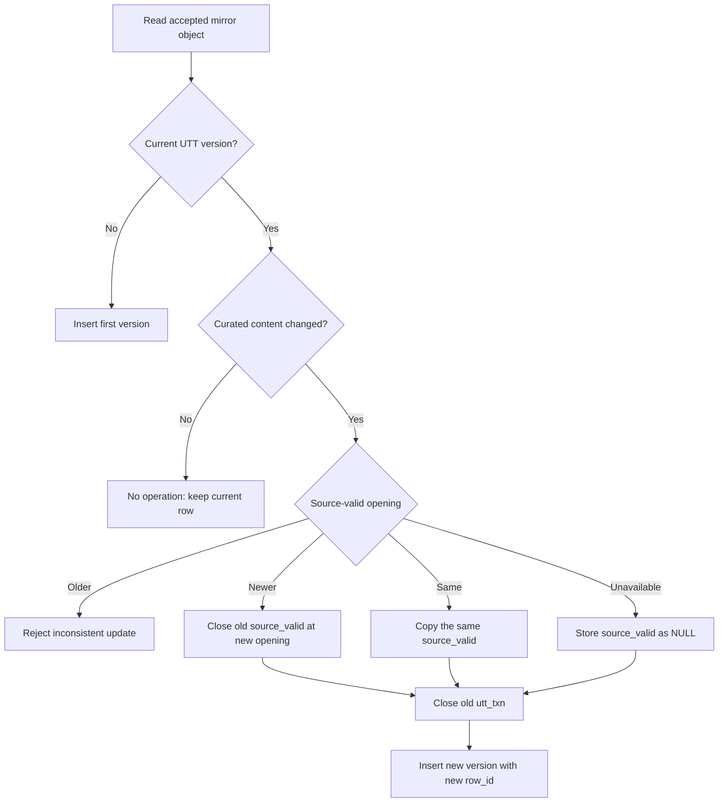

# Temporal curation

UTT keeps changed curated facts as versions instead of overwriting them. This guide
defines the common temporal structure and update decision for temporal `utt` tables
and `utt_pkg.curate_*` routines.

## Model

Each stored version has an internal identity, a stable source identity and up to two
time axes:

```sql
row_id       bigint GENERATED ALWAYS AS IDENTITY PRIMARY KEY,
id           text NOT NULL,
source_valid tstzrange,
utt_txn      tstzrange NOT NULL
```

- `row_id` is the immutable internal identity of one stored version.
- `id` identifies the logical source object and repeats across its versions.
- `source_valid` records when the source says that version applies. It is `NULL`
  when no source-backed value or documented source-specific inference is available.
- `utt_txn` records when UTT considered the version current.

Ranges are half-open: `[start, end)`. The end is unbounded while a version remains
current on that time axis.

For one logical object, system-time ranges never overlap. Source-valid ranges may
repeat across system-time versions when corrected content retains the same source
validity. The database constraints therefore use:

```sql
EXCLUDE USING gist (id WITH =, utt_txn WITH &&);

EXCLUDE USING gist (
    id WITH =,
    source_valid WITH &&,
    utt_txn WITH &&
)
WHERE (source_valid IS NOT NULL);
```

## Update decision

A source revision or ingestion by itself does not create a version. Curation compares
the current UTT version with the accepted local mirror data. The comparison covers
geometry and every curated attribute describing object state. A deterministic content
hash may replace direct comparison, but it excludes `row_id`, `utt_txn` and other
UTT-generated metadata.

A **no-op** (short for "no operation") means that the curation call completes
successfully without changing the database for that object. It does not insert a new
version, update the current row, or change either time range. When the complete input
is unchanged, the current curation routines return `0` inserted versions.



For unchanged content, keep the current row and its `source_valid`, even when the
source advertises a newer revision. This prevents periodic metadata updates from
creating empty history.

For changed content, capture one database timestamp. Use it both to close the old
`utt_txn` and open the new one. If the incoming source-valid opening is newer, also
close the old `source_valid` at that opening and open the new range there. If source
validity is unchanged, copy the same range to the new system-time version. If it is
unavailable, store `NULL`.

```text
source_valid:  [source A----------source B---------------)
utt_txn:       [UTT version 1----)[UTT version 2--------)
                                  ^ one database timestamp
```

Repeated processing of unchanged content must make no database change. The resulting
history contains one new UTT version per observed content change, rather than one per
source check or ingestion run.

## Current implementation

`utt.city`, `utt.district`, `utt.block`, `utt.plot`, `utt.building` and `utt.address`
implement this model. City, district and building
curation use registry `source_revision_at` as a documented source-specific
valid-time opening. Their change detection compares each routine's mapped content,
including geometry. Block curation compares
geometry, planning area and district, and uses the feature's `datum` as its
valid-time opening. Plot and address curation use their features' `beg` and `aufn_dt`
dates respectively. `clock_timestamp()` supplies system time. A temporal-metadata-only
change leaves the current row unchanged; curated content changes create a version.

The three geometry-derived relation tables do not add temporal ranges. They reference
the immutable `row_id` values of their endpoint versions, whose `source_valid` and
`utt_txn` ranges provide the relation's temporal context.
